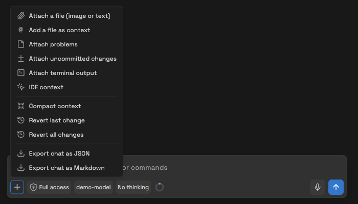

Use a chat to describe an outcome, give Rath material to work with, and follow its response. You can correct its direction while it works or save a separate question for after the current one.

Before you start, open a Rath chat and connect a provider. See [Getting started](/rath-docs/getting-started/) if you need help. To share terminal output, first open the terminal and make sure it contains the output you want to discuss. A terminal is a place where commands run and print their results.

## Send a request

1. Type what you want in the message box. Include the result you expect and any constraints that matter.
2. Press Enter or select the arrow button, **Send**. Your message appears in the conversation and Rath begins responding.
3. Read the response and ask a follow-up in the same chat if you need a correction or more detail.

For example, try: “Summarize this project for a new teammate in five bullet points.” Or attach a picture and ask: “Describe this screen and suggest three ways to make it easier to use.” Rath's response depends on the material and the model available to your provider.

## Add material to a message

1. Select the plus button, **Attach, context, and session actions**.
2. Choose **Attach a file (image or text)** and select a picture or plain-text file. Alternatively, choose **Add a file as context** and pick a file from the suggestions.
3. Check the attachment shown by the message box. Select **Remove** on an attachment if you chose the wrong one. Add your question and send it.

The same plus menu offers **Attach terminal output**, **Attach problems**, and **Attach uncommitted changes**. Problems are errors and warnings reported in your workspace; uncommitted changes are edits not yet saved in a version-control snapshot. For example, after a command fails, choose **Attach terminal output** and ask: “Explain this error in plain language and suggest what to check first.” Review the output before sharing it, since it may contain information you do not want to send.

To include the active editor file and selection, open the plus menu and select **IDE context**. The check mark shows it is on; select it again to turn it off. This is useful when asking, “Explain the selected passage.” The plus menu also contains **Compact context** and change-revert actions; see [Context](/rath-docs/context/) and [Reviewing changes](/rath-docs/reviewing-changes/) before using them.

The composer also has permission, model, and **Reasoning effort** controls. Choose these before Rath starts working; while it works, they may say **Available again when the agent finishes**. See [Permissions](/rath-docs/permissions/) and [Models](/rath-docs/models/) for the choices.

## Change direction or wait your turn

1. While Rath is working, type your next message. To change the current task, try: “Focus on the mobile layout first.” To ask a separate question afterward, try: “When you finish, summarize the changes for me.”
2. Check the send button's hint: it says whether an ordinary send will redirect the current work or queue a new question. Press Command+Enter on a Mac or Ctrl+Enter elsewhere to choose the other action.
3. A redirect is incorporated when Rath reaches a suitable point; it may show **Queued** while waiting. A queued question waits for the current work to finish and then starts its own turn. A count such as **1 queued** can appear on the composer.

To stop the current work, leave the message box empty and select the square **Stop** button. If there is text in the box, sending it instead redirects or queues that text.

## If it doesn't work

- If you see **The message was not sent: Rath is not connected. Use Retry, then send it again.**, select **Retry** and resend your message. See [Troubleshooting](/rath-docs/troubleshooting/) if the connection still fails.
- If Rath says the active terminal has no output to attach, select the terminal containing the output and try **Attach terminal output** again. Similarly, **Attach problems** reports when there are no errors or warnings to attach.
- An attachment may be too large or unreadable. Try a smaller file or picture. Rath also reports that binary files such as PDFs and archives cannot be attached this way; use a plain-text extract instead.

For more ways to supply material, see [Context](/rath-docs/context/). To understand questions Rath may ask during work, see [Questions](/rath-docs/questions/).
