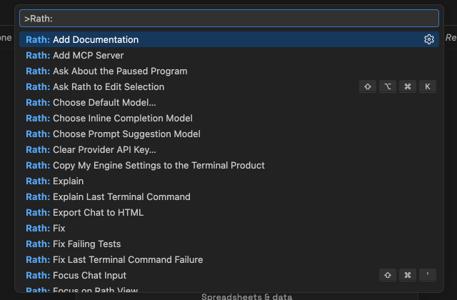

Use the Command Palette to start a Rath action by name, from opening a chat to asking for help with selected text. Use the linked guides for more detail.

Before you start, connect a model provider for actions that ask Rath to work. Open the relevant folder or chat, or select text in the editor, if the action needs it.

1. Press Command+Shift+P on a Mac or Ctrl+Shift+P elsewhere to open the **Command Palette**.
2. Type a command name from the table, such as **Rath: Quick Ask**, and select the matching result.
3. Follow the prompt or inspect the view that opens. For a task, check Rath's response and review any changes it makes.

For example, choose **Rath: Quick Ask** and type “Summarize this project in five points.” To find a previous discussion, choose **Rath: Search Message History…** and enter a phrase from it. To change selected text, choose **Rath: Ask Rath to Edit Selection** and type “Make this paragraph shorter.”

The names below include the **Rath:** prefix shown in the palette. Some commands appear only in a particular window or when their conditions are met. A dash means there is no linked guide for that command.

## Chats and work

| Command | What it does | Guide |
| --- | --- | --- |
| Rath: Quick Ask | Starts a new chat with a question. | [Quick Ask](/rath-docs/quick-ask-and-model-switching/) |
| Rath: New Chat | Opens a new chat. | [Sessions](/rath-docs/sessions/) |
| Rath: Show Rath Sessions | Opens the sessions view. | [Sessions](/rath-docs/sessions/) |
| Rath: Toggle Rath Sidebar | Shows or hides the Rath sidebar. | [More Rath commands](/rath-docs/more-commands/) |
| Rath: Focus Chat Input | Moves focus to the chat message box. | [More Rath commands](/rath-docs/more-commands/) |
| Rath: Search Message History… | Searches messages across chats in the open folder. | [History and export](/rath-docs/history-and-export/) |
| Rath: Export Chat to HTML | Saves the active chat as a web page. | [History and export](/rath-docs/history-and-export/) |
| Rath: Open Knowledge Graph | Opens the graph of session relationships. | [More Rath commands](/rath-docs/more-commands/) |
| Rath: Tap or Hold to Record | Starts or stops dictation when the chat message box is active. | [Dictation](/rath-docs/dictation/) |
| Rath: Open Debug View for This Chat | Opens diagnostic details for the active chat. First enable `rath.agent.debugView` in Settings; it is off by default. | — |
| Rath: Show Automation Action Log | Opens recorded automation action decisions. | [Automations](/rath-docs/automations/) |
| Rath: Show Automation Result | Opens the latest saved automation result. | [Automations](/rath-docs/automations/) |

## Models and connections

| Command | What it does | Guide |
| --- | --- | --- |
| Rath: Connect a Model Provider | Starts provider setup. | [Getting started](/rath-docs/getting-started/) |
| Rath: Sign In with a Subscription (Anthropic, GitHub Copilot, ChatGPT)… | Connects a supported subscription. | [Provider connections](/rath-docs/provider-connections/) |
| Rath: Set Provider API Key… | Sets up a provider credential. | [Provider connections](/rath-docs/provider-connections/) |
| Rath: Clear Provider API Key… | Removes a saved provider key. | [Provider connections](/rath-docs/provider-connections/) |
| Rath: Sign Out of a Subscription… | Disconnects a subscription. | [Provider connections](/rath-docs/provider-connections/) |
| Rath: Choose Default Model… | Chooses the starting model for new chats. | [Models](/rath-docs/models/) |
| Rath: Choose Prompt Suggestion Model | Chooses a model for suggestions while typing a message. | [More Rath commands](/rath-docs/more-commands/) |
| Rath: Switch to Next Model | Selects the next available model in the active chat. | [Model switching](/rath-docs/quick-ask-and-model-switching/) |
| Rath: Switch to Previous Model | Selects the previous available model in the active chat. | [Model switching](/rath-docs/quick-ask-and-model-switching/) |
| Rath: Choose Inline Completion Model | Chooses a model for suggestions in the editor. | [Inline completions](/rath-docs/inline-completions/) |
| Rath: Trigger Inline Completion | Requests an editor suggestion. | [Inline completions](/rath-docs/inline-completions/) |
| Rath: Toggle Inline Completions for This Language | Turns editor suggestions on or off for the current language. | [Inline completions](/rath-docs/inline-completions/) |

## Editor and project tasks

| Command | What it does | Guide |
| --- | --- | --- |
| Rath: Ask Rath to Edit Selection | Opens a request for an edit to selected text. | [Editor helpers](/rath-docs/editor-helpers/) |
| Rath: Explain | Explains selected text in the active editor, or the current line if nothing is selected. | [Editor helpers](/rath-docs/editor-helpers/) |
| Rath: Fix | Asks Rath to fix selected text, or the current line if nothing is selected. | [Editor helpers](/rath-docs/editor-helpers/) |
| Rath: Generate Tests | Asks Rath to write tests for selected text, or the current line if nothing is selected. | [Editor helpers](/rath-docs/editor-helpers/) |
| Rath: Add Documentation | Asks Rath to document selected text, or the current line if nothing is selected. | [Editor helpers](/rath-docs/editor-helpers/) |
| Rath: Resolve Merge Conflicts | Asks Rath to reconcile conflicting changes. | [Workflow helpers](/rath-docs/workflow-helpers/) |
| Rath: Fix Failing Tests | Asks Rath to investigate and fix test failures. | [Workflow helpers](/rath-docs/workflow-helpers/) |
| Rath: Write Pull Request Description | Asks Rath to draft a description of the changes for review. | [Workflow helpers](/rath-docs/workflow-helpers/) |
| Rath: Explain Last Terminal Command | Asks Rath to explain the active terminal's output. | [Workflow helpers](/rath-docs/workflow-helpers/) |
| Rath: Fix Last Terminal Command Failure | Asks Rath to investigate a terminal failure. | [Workflow helpers](/rath-docs/workflow-helpers/) |
| Rath: Ask About the Paused Program | Asks Rath to explain a program paused during debugging. | [Editor helpers](/rath-docs/editor-helpers/) |

## Tools and customization

| Command | What it does | Guide |
| --- | --- | --- |
| Rath: Manage Tools… | Opens the tools screen. | [Tools screen](/rath-docs/tools-screen/) |
| Rath: Manage Packages… | Opens the packages screen. | [Packages and plugins](/rath-docs/packages-and-plugins/) |
| Rath: New Prompt (Slash Command) | Creates a reusable prompt. | [Prompts, skills, and project instructions](/rath-docs/prompts-skills-and-instructions/) |
| Rath: New Skill | Creates a reusable skill. | [Prompts, skills, and project instructions](/rath-docs/prompts-skills-and-instructions/) |
| Rath: Open Project Instructions (AGENTS.md) | Opens project instructions for Rath. | [Prompts, skills, and project instructions](/rath-docs/prompts-skills-and-instructions/) |
| Rath: Add MCP Server | Adds a connection to a service offering tools. | [MCP servers](/rath-docs/mcp-servers/) |
| Rath: Show What My Organization Restricts | Reports restrictions set by your organization. | [Organisation policy](/rath-docs/organisation-policy/) |
| Rath: Undo the Agent's Last Setting Change | Reverses the latest setting change made by Rath. | [Appearance and themes](/rath-docs/appearance-and-themes/) |
| Rath: Show Hidden Composer Widgets | Brings back hidden additions above the message box. | [Making Rath yours](/rath-docs/customizing/) |
| Rath: Open My Stylesheet | Opens your personal appearance rules. | [My stylesheets and UI sync](/rath-docs/my-ui-stylesheets-and-sync/) |
| Rath: Turn Off My Stylesheets | Turns off your personal appearance rules. | [My stylesheets and UI sync](/rath-docs/my-ui-stylesheets-and-sync/) |
| Rath: Turn On My Stylesheets | Turns your personal appearance rules back on. | [My stylesheets and UI sync](/rath-docs/my-ui-stylesheets-and-sync/) |
| Rath: Show What My UI Loaded | Shows which personal interface additions were loaded. | [My stylesheets and UI sync](/rath-docs/my-ui-stylesheets-and-sync/) |
| Rath: Restore an Earlier Version of My UI | Offers an earlier version of your interface changes to restore. | [My stylesheets and UI sync](/rath-docs/my-ui-stylesheets-and-sync/) |
| Rath: Set Up Sync for My UI | Sets up synchronization of interface changes. | [My stylesheets and UI sync](/rath-docs/my-ui-stylesheets-and-sync/) |
| Rath: Sync My UI Now | Synchronizes interface changes. | [My stylesheets and UI sync](/rath-docs/my-ui-stylesheets-and-sync/) |
| Rath: Manage Extensions the Agent Wrote | Opens management for extensions written by Rath. | [My stylesheets and UI sync](/rath-docs/my-ui-stylesheets-and-sync/) |
| Rath: Copy My Engine Settings to the Terminal Product | Copies supported settings you have changed for use when running Rath in a terminal, after you confirm. | [More Rath commands](/rath-docs/more-commands/) |

## If it doesn't work

- If a command is missing, check its conditions in the table. For dictation, focus the chat message box; for the debug view, enable `rath.agent.debugView` in Settings.

- If model switching says **Open a Rath chat first.**, open the chat you want to change. **More than one model is needed to switch models.** means you need another available model; see [Models](/rath-docs/models/).
- If history search says **Open a folder first — message history is scoped per workspace.**, open the folder containing the chat and try again. A deleted chat can produce **That chat could not be found any more. It may have been deleted.**
- If a terminal action says **The active terminal has no output to look at.**, select a terminal containing output first. For a paused program, **The program is not paused in the debugger.** means there is no paused state to explain.

For setup and connection problems, see [Troubleshooting](/rath-docs/troubleshooting/). For controls outside the palette, see [Chatting](/rath-docs/chatting/) and [Settings reference](/rath-docs/settings-reference/).
