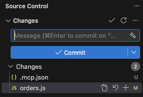

Use Rath to draft a commit message that describes your changes for your project's history. This is useful when you have finished a set of related edits and want a starting point for the description.

Before you start, open a Git project with changes in **Source Control**. You need an API key and model from one of these providers: OpenAI, DeepSeek, Groq, Together, Fireworks, OpenRouter, Mistral or xAI. A ChatGPT or Claude subscription login cannot be used for this feature. The message generator uses its own model settings, which can differ from the model selected in chat. See [Provider connections](/rath-docs/provider-connections/) for API keys.

## Generate and review a message

1. Open **Source Control** and choose the repository containing your changes. If you want the message to cover a particular set of changes, select **Stage Changes** for those changes. Staging selects changes for the next snapshot.
2. In the repository's message box, select the sparkle button, **Generate Commit Message**. If asked to choose a model, select **Choose Model**, pick one, and select the sparkle again.
3. The generated text appears in the message box. Read it against the changes you intend to commit, correct anything misleading, and add any issue reference or other details your team needs.
4. When the message and selected changes are ready, select **Commit**. Generating the message alone does not create a commit.

If there are staged changes, Rath describes those. If nothing is staged, it uses the available changes to previously tracked files instead; new untracked files are not included in that fallback. Stage a new file if it needs to be described. Rath sends at most the first 60,000 characters of changes, so a large set of edits can be cut off. Check the draft for omissions. Generating again replaces the message when a nonempty answer arrives, so keep any wording you want first.

Rath sends the changes, repository and branch names, and up to ten recent commit subjects to the selected provider. It asks the model to follow the recent message style. Check what you are sharing and review the result: the style and description are suggestions, not guarantees.

## Choose the model and style

1. Open **Settings** and search for `commit messages`. Under **Rath › Agent › Commit Messages**, find **Provider** and **Model**.
2. Choose a supported provider and enter a model ID available from it. Open the Command Palette, search for **Rath: Set Provider API Key…**, and set the key for that provider. Check the provider's pricing and limits; requests use that provider's service.
3. Optionally use **Instructions** to enter your team's preferred format. Generate again to apply the instructions, then review the result.

Both dedicated provider and model settings start blank. Each blank value falls back to its corresponding prompt-suggestion setting; the prompt-suggestion provider starts as DeepSeek, and its model starts blank. **Choose Model** fills the prompt-suggestion model, so check that its provider matches any separate provider you selected for commit messages. Changing the chat model does not change these settings.

For a corrected typo, type “Begin the subject with docs:” in **Instructions**, then generate a message. For several related accessibility edits, try “Use a brief subject followed by a blank line and a short explanation.” Check that the result captures the shared purpose. These instructions are entered in Settings, not in the chat message box.

## If it doesn't work

- **Choose a model for Rath to write commit messages with.** Select **Choose Model**. If the picker cannot find a list, choose **Enter model id manually…** and enter an available model ID.
- **No API key is set for [provider]. Set one with Rath: Set API Key.** The notice names the command differently. Run **Rath: Set Provider API Key…** and set the key for the provider used by the generator. If **The API key for [provider] was rejected.** appears, check the key and provider and try again.
- **There are no changes to describe.** Make or stage a change and try again. If only new files are present, stage them first. If **Couldn't generate a commit message:** appears, use the detail in the notification to check the provider, model, connection or allowance and retry. An empty answer can leave the message box unchanged.

See [Reviewing changes](/rath-docs/reviewing-changes/) for checking edits and [Models and thinking level](/rath-docs/models/) for chat model choices.
