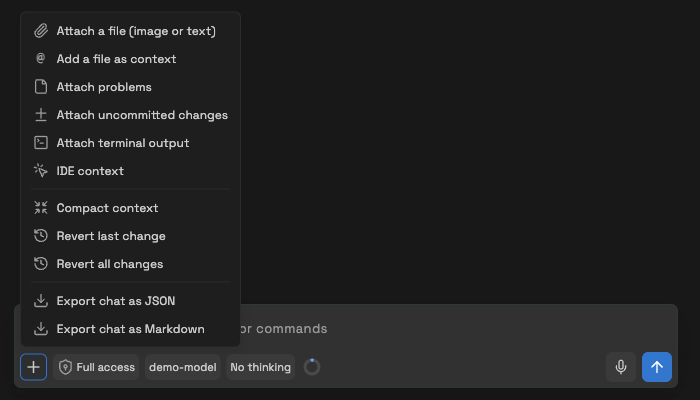

Use context controls to keep a long task going when Rath has a lot to consider. Context is the information available to the model for its next response: your conversation, attached material, and results of actions such as reading a file. The model has a limited amount of room, measured in tokens (small pieces of text). As work accumulates, the ring helps you see how much of that room is used.

Before you start, open a chat and send a message. The ring is hidden until usage is known, so it may not appear before the first answer.

## Check the ring and make room

1. Look for the small ring beside the message box. Point to it to see the percentage of context in use. A fuller ring means more of the available context is in use. Its colour changes at 75% and again at 90%; use the percentage to check the amount without relying on colour.
2. If you want to continue the same long task with more room, wait until Rath has finished responding. Select the ring, or the plus button labelled **Attach, context, and session actions**.
3. Select **Compact context**. Rath replaces earlier messages in the context with a summary. The full conversation history is kept, but the summary can leave out details, so repeat anything that must be exact in your next message.
4. Look for **Conversation compacted** in the conversation. The row may show token counts and a **Working state** section. The ring may still show its previous fill immediately afterwards; its hover says **Compacted — usage updates after your next message**, or gives a token figure. Send your next message and check the ring again after Rath responds.

For example, after a long document review, compact and say: “Continue the review. Keep the recommendation that the deadline is 30 June.” For a long planning conversation, try: “Summarize the remaining decisions and use the £5,000 budget we agreed.” Check Rath's response against the details you need; a summary is not a word-for-word copy.

## What Rath clears automatically

By default, Rath removes older, large results of its actions from what the model sees as context fills. For example, a result might be the text returned when Rath reads a document. Recent results are kept, and Rath can read a document again if needed. The full history remains available.

You may see **Cleared 2 old tool results** in the chat, sometimes followed by an approximate number of tokens saved. “Tool results” means results of actions like reading a document. Clearing results is separate from compacting the conversation. If an old detail matters, you can say: “Please read the proposal again and check the delivery date before answering.”

The default threshold for clearing is 50% context. To change it, open Settings and find **Context: Clear At Percent** under **AI > Context**. A lower value saves more space but can cause more rereading. Changes apply to new chats. See [Context settings](/rath-docs/settings-context/) for the other options.

## When to start a new chat

Choose a new chat for a distinct task, or when a long conversation has become difficult to steer even after compacting. In the chat list, select **New chat**, then give Rath the new goal and any material it needs. For example: “Review this proposal for unclear deadlines. List each one and suggest a clearer wording.” A new conversation needs its own instructions; include important constraints rather than assuming the earlier chat is in its context. You can return to the earlier chat from the list.

## If it doesn't work

- **The ring is missing:** usage is not yet known. Send a message and wait for an answer, then check again.
- **Compact context is unavailable:** wait for Rath to finish responding and for the chat to be ready, then open the menu again.
- **The ring still looks full after compacting:** its fill can be the last known value. Send a message and check after the next response.

See [Chatting](/rath-docs/chatting/) for attachments, [Chats and sessions](/rath-docs/sessions/) for returning to earlier work, and [Models](/rath-docs/models/) for choosing a model.
