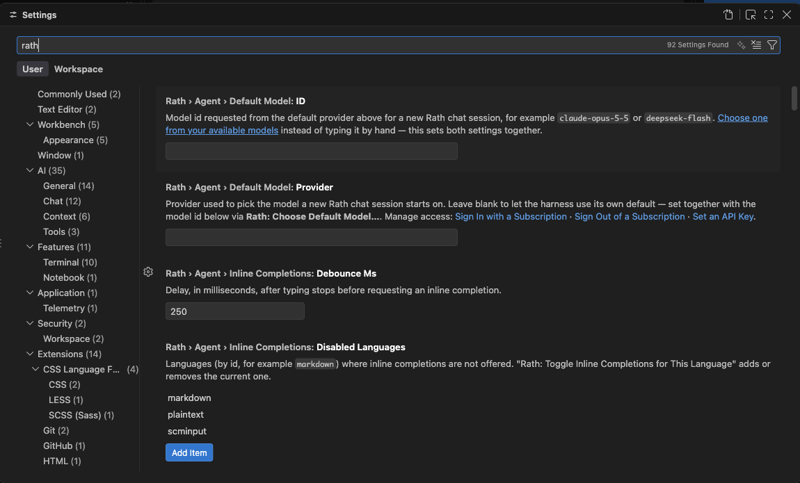

*Early: appearance changes and custom widgets are still being checked across different setups.*

Make Rath more comfortable to use by choosing what it may change, showing or hiding your additions, and making more room above the message box. You can ask for a small addition in ordinary language. Start with one change so it is easy to see whether you like the result.

**Before you start:** Open a Rath chat. To ask Rath to make an appearance change, select **Full access** in the chat's permission control. This also grants other abilities, so read [Permissions](/rath-docs/permissions/) before choosing it.

## Ask for an addition

1. Open **Settings**, then **AI** > **Rath Features**. Under **Change how Rath looks**, find **Agent changes to appearance**.
2. Choose **Lean** for custom additions, or **Full** if you also want Rath to change appearance settings after asking you. **Lean** is the registered default. It adds about 200 tokens—small pieces of text—to each message Rath reads; **Full** adds about 400. Choose **Off** to prevent agent appearance changes.
3. Make sure **Your styles and additions** is on. It is on by default and controls whether your own additions are loaded.
4. In the chat, try: “Add a small footer below my chat box showing the model and context usage.” Look below the message box for the result. You can then ask: “Make that footer less prominent.”

If you choose **Full**, start a new chat for its extra abilities. If Rath proposes a setting change, **Allow the Agent to Change a Setting?** shows the current and new values. Choose **Allow** only if you want that change. A request may need clarification or produce a different result; describe the location and the content you want as specifically as you can.

## Make more room or bring additions back

1. In **AI** > **Rath Features**, find **Task checklist** under **Show things to you**. Turn it off if you do not want the checklist above the chat box while Rath works through a plan. Turn it on again to show it. It is on by default.
2. To hide your own styles and additions together, turn off **Your styles and additions**. Turn it back on when you want them loaded again. This is separate from **Agent changes to appearance**: switching the latter to **Off** stops new agent changes but does not itself hide your existing additions.
3. If an existing widget above the message box has a hide control, use it to remove the widget from view. To bring hidden widgets back, open the Command Palette and choose **Rath: Show Hidden Composer Widgets**. Rath reports **The hidden widgets above the composer are back.** If none are hidden, it reports **No composer widget is hidden.**

For example, turn off **Task checklist** when you want more space for a long conversation, or turn off **Your styles and additions** to check how the standard appearance looks. To request another change in chat, try: “Remove the footer you added below my chat box.”

## If it doesn't work

- If Rath says an appearance change is turned off, check **Agent changes to appearance**, the chat's **Full access** permission, and **Your styles and additions**. For the extra **Full** abilities, use a new chat.
- If you see **Your custom look hid a part of the window that must stay visible, so it was paused. Your widgets still work.**, the custom look has been paused to keep the window usable. Ask Rath to adjust the look before trying it again.
- If you see **Your organization has turned customizations off.**, an organization setting is limiting them; ask your administrator for help. Notices for every restricted state are still being verified, so a missing notice does not establish that customization is available.

See [Chatting](/rath-docs/chatting/), [Permissions](/rath-docs/permissions/), and [Rath Features settings](/rath-docs/settings-features/) for more controls.

See [Changing how Rath looks](/rath-docs/appearance-and-themes/) for themes, styles, and appearance setting approvals.
