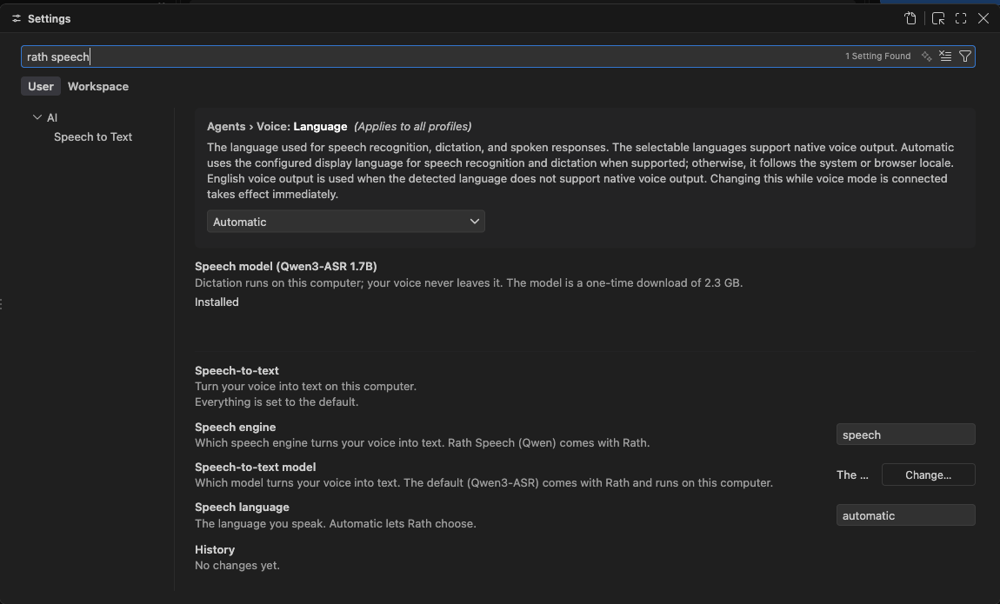

Speak a request into the chat message box when it is easier than typing. Rath turns your voice into text for you to review and send. The built-in speech model runs on your computer; the speech model is separate from the model that answers your chat.

Before you start, open a Rath chat, connect a microphone and allow Rath access to it. You also need an internet connection and disk space for the one-time model download. The Settings page shows its size before installation.

## Install the built-in speech model

1. Open **Settings**, then choose **AI** and **Speech to Text**. You can also search Settings for “speech”.
2. Find **Speech model (Qwen3-ASR 1.7B)**. If it says **Not installed**, select **Install**.
3. Wait while **Downloading…** and a progress bar appear. You can select **Cancel** to stop the download. When the row says **Installed**, the model is ready for dictation.

The built-in model turns speech into text on your computer. Downloading it does not send a chat request; you still choose when to send the resulting text.

## Speak a message

1. In a Rath chat, place the cursor where you want the words in the message box. Select the microphone, whose hint says **Tap or hold to record**. With the message box focused, you can also press Command+Period on a Mac or Ctrl+Period elsewhere.
2. Speak your request. A waveform indicates recording; the microphone hint changes to **Stop Dictation**. If the speech model is still preparing, wait for recording to start.
3. Tap the microphone or shortcut again to stop. Alternatively, hold the button or shortcut while speaking and release it to stop.
4. Check the words in the message box and correct any mistakes. Select **Send** when the request says what you intended.

Try saying “Summarize these notes in five bullet points.” For a longer request, try “Explain this proposal in plain language, then list three questions I should ask.” To continue a conversation, try “Make the previous answer shorter and use a friendly tone.” Review names, numbers and punctuation before sending, especially when they affect the answer.

<!-- SCREENSHOT: Chat composer recording speech with the waveform visible -->

## Adjust speech settings

In **Speech to Text**, **Speech language** defaults to **automatic**, which lets Rath choose the language. Enter a language code such as `en`, `de` or `pt-br` to specify one; use **Reset** to return to the default. The change applies the next time you start dictation.

If you already have a compatible speech model and know its kind, you can choose it under **Speech-to-text model**. Otherwise, use the built-in model above.

1. Select **Change…**, then choose the model in **Choose the Speech Model File**.
2. At **Give the model a short name**, accept or enter a name. At **Which kind of model is it?**, choose the kind supplied with your model.
3. Confirm the change when prompted. The next dictation uses the new choice. The row shows **Using your own model:** followed by its name and, if found, **The model file is there.**
4. To return to the built-in choice, select **Reset** for **Speech-to-text model**. If necessary, install the built-in model as described above.

Changing the speech model changes transcription, not the model that generates Rath's answer. A model choice requires your confirmation; check the result of a short dictation before relying on it.

## If it doesn't work

- **The speech-to-text model is not installed yet. Install it in Settings, under Speech to Text.** Select **Open Settings**, then install the model.
- **Download failed** or **Speech engine unavailable**: read the detail shown and select **Retry**. If the download failed, check your connection and available space. **Dictation is not available in this window.** means this window cannot use it.
- **Could not access the microphone for speech-to-text:** check that the microphone is connected and that your computer permits Rath to use it, then try again. If the text is inaccurate, correct it before sending and try specifying **Speech language**.
- **The model file could not be found. Choose another model or reset to the default.** Choose it again or select **Reset to Default**, then install the built-in model if needed.

See [Chatting](/rath-docs/chatting/) for sending and correcting requests, [Models](/rath-docs/models/) for the model that answers them, and [Troubleshooting](/rath-docs/troubleshooting/) for connection help.
