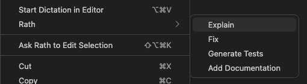

This feature is new; if something behaves differently from this page, tell us.

Use editor helpers when you have a particular piece of work in front of you and want Rath to start with it. You can ask for an explanation, a fix, comments, checks, or a specific edit. When a program is paused, you can also ask about its current state or a value. Review the answer and any edits before relying on them.

## Before you start

Open your project and connect a model for Rath. Open the relevant content in the editor. For actions that change work or run checks, choose an appropriate [permission mode](/rath-docs/permissions/). A test is a check that a program behaves as expected; debugging means pausing a program to inspect what it is doing.

## Explain, fix, document or test

1. Select the relevant text in the editor. If you select nothing, these four actions use the line containing the cursor.
2. Right-click in the editor, open **Rath**, and choose one action:
   - **Explain** asks for a plain-language explanation and instructs Rath not to change files.
   - **Fix** asks for the smallest correction and includes editor warnings or errors overlapping the selection.
   - **Add Documentation** asks for documentation comments in the project's style, without changing the code itself.
   - **Generate Tests** asks for normal and edge cases using the project's existing test conventions, and to run the tests if possible.
3. Read the new task in chat: its title is **Explain Code**, **Fix Code**, **Add Documentation**, or **Generate Tests**. Follow up if you need more detail, and [review any changes](/rath-docs/reviewing-changes/).

For example, select an unfamiliar calculation and choose **Explain**, then ask “Can you explain that with a small example?” Select a section with an error and choose **Fix**, then ask “What caused the problem?” For a function that needs checks, choose **Generate Tests** and follow up with “Which edge cases did you cover?”

## Request a specific edit

1. Select the text you want changed. Without a selection, the request concerns the whole open file.
2. Right-click and choose **Ask Rath to Edit Selection**, or find **Rath: Ask Rath to Edit Selection** in the Command Palette.
3. In **Describe the edit…**, type what you want, such as “Rename this heading to Welcome and make the paragraph shorter.” Press Enter or select **Send**. Use Escape or **Cancel** to close the box without sending.
4. The request goes to the active Rath chat, or a new chat if there is none. Read Rath's response and inspect any edits. The box sends an instruction; it does not itself show an accepted edit.

## Ask about a chat selection

1. Select a passage in a Rath response and right-click it.
2. Choose **Ask Rath**. The selected passage appears as a quote in the message box; it is not sent yet.
3. Add a question such as “What does this mean for my project?” and send it. Rath can then answer with the quoted passage in context.

## Ask about a paused program

1. Pause the program in the debugger and select the relevant entry in the call stack, the list of active steps in the program.
2. Right-click the entry and choose **Ask About the Paused Program**, or choose **Rath: Ask About the Paused Program** in the Command Palette. A new **Explain Paused Program** task asks Rath to explain the location and any surprising values without changing files.
3. To investigate one value, right-click it in the debugger's variables view and choose **Ask Rath About This Variable**. A **Debug Variable** task asks why the value might occur and whether it is a problem.
4. Read the explanation and follow up, for example: “What should I check next to understand this value?”

## What to know

The four editor actions include at most 12,000 characters of selected text in their initial request. The paused-program action includes up to 25 variables from the first available scope when they can be read; a variable's own value is limited to 1,000 characters for its dedicated action. These are requests to the model, so check its conclusions and changes. The current request-to-result experience has not been confirmed with a live model in this documentation review.

## If it doesn't work

- **The program is not paused in the debugger.** Pause it and select a call-stack entry before trying again.
- If an editor action does nothing, focus an open editor and try again. The inline edit action also does nothing for unsupported views; open the editable content itself.
- If no variable action appears, select and right-click a variable in the debugger. If Rath cannot make an edit or run a test, check the permission mode and any approval request; an explanation or generated test still needs your review.

## Related pages

- [Chatting with Rath](/rath-docs/chatting/)
- [Permission modes](/rath-docs/permissions/)
- [Reviewing changes](/rath-docs/reviewing-changes/)
