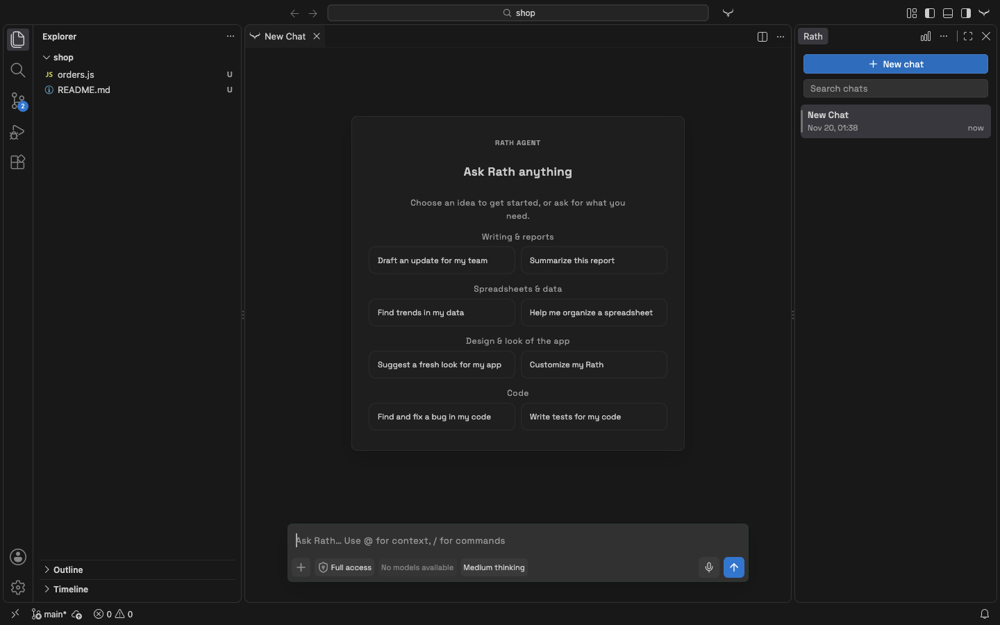

Rath helps you understand and work with the contents of a folder through conversation. This guide walks you through connecting a model provider and asking your first question. Start with a request to explain your materials; once you are comfortable with the permission controls, you can ask for changes.

## Before you start

Have Rath installed, a folder of material to explore, and an account with a model provider—the service that supplies the AI model. Depending on the provider, you can connect with an eligible subscription or an API key. Get an API key from your provider or the person managing your organisation's account, and keep it private. Provider charges and limits depend on your account and plan. See [Connect a model provider](/rath-docs/provider-connections/) for more detail.

Your messages and material Rath reads to answer them are sent to the selected model provider. Choose a folder and provider appropriate for the information you want to share.

## Start your first chat

1. Open Rath. Choose **File > Open Folder...** and select your folder. On macOS, you can also choose **File > Open...** and select a folder. If asked whether you trust the folder, read the prompt and decide whether you trust its contents.
2. Open the Rath sidebar using the **Toggle Rath Sidebar** button in the top bar, then select **New chat**. The chat opens in a tab. Keep it open for subscription sign-in.
3. Open the Command Palette with **Control+Shift+P** on Windows or Linux, or **Command+Shift+P** on macOS. Type and select **Rath: Set Provider API Key…**. Choose **Use a subscription** or **Use an API key**, select your provider, and follow the prompts. For a key, enter it at **Set Rath API Key**.
4. Beneath the message box, open **Permission** and choose **Read-only**. Rath can inspect and search the folder without changing its files. See [Permission modes](/rath-docs/permissions/) before asking it to make changes.
5. Next to the permission control, select the model name to open the model list. Choose an available model from the provider you connected.
6. Type “Explain what is in this folder and suggest where I should start,” then select **Send**.

You should see your message followed by Rath's activity and response. Ask a follow-up if you need a simpler explanation or want it to focus on one item. Check important details against the original material before using or sharing the answer.

## Try another request

- For meeting notes, type “Summarize the main decisions in these meeting notes.” Compare the summary with the notes before sharing it.
- To investigate a date, type “Find documents that mention the launch date and tell me what each says.” Ask Rath to identify its sources so you can check them.
- When joining a project, type “Explain this folder as if I am new to the project.” Follow up with “What should I read first?”

## If it doesn't work

- **Open a folder to start the Rath agent.** Open a folder as described above and try again.
- **Sign in to continue** means the selected model needs a provider connection. Connect its provider or choose a model from a provider you have connected.
- **No active Rath chat to sign in through — open a chat first.** Select **New chat** and repeat subscription sign-in.
- **API key is required.** Enter a nonempty key. If the provider rejects it, check the key and your provider account.

For a waiting or failed answer, see [Troubleshooting](/rath-docs/troubleshooting/). Next, explore [Chatting](/rath-docs/chatting/), [Models and thinking level](/rath-docs/models/), and [Sessions and history](/rath-docs/sessions/).
