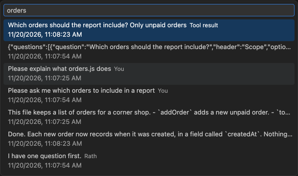
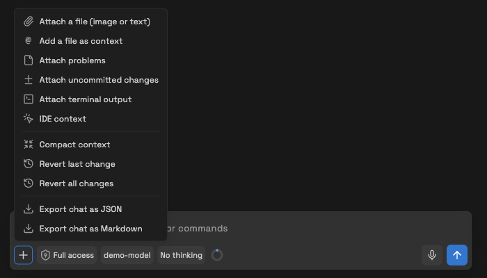

Find an earlier answer even when you cannot remember the chat's title, then save a copy for reading or further work. Message search looks across chats in the current workspace. Export saves the conversation you have open.

Before you start, open the folder associated with the conversation. For an export, open a chat that already has messages. A workspace is the folder or group of folders you have open in Rath.

## Find a message

1. Open the Command Palette and choose **Rath: Search Message History…**.
2. In **Search everything said across every Rath session in this workspace…**, type words you remember. For example, try `meeting agenda` if you previously asked Rath, “Draft a meeting agenda for the project kickoff.” Results update as you refine the search.
3. Look at the preview and its label: **You** identifies your message and **Rath** an answer. A result can also identify thinking, a tool call, or a tool result. A date and time appear when available.
4. Select a result to open its chat. Rath attempts to move to the matching text when it is displayed in the conversation. If an older message has not been drawn yet, the chat still opens, but you may need to find the message yourself.

For another example, search `renewal deadline` to return to a chat where you asked, “Summarize the renewal deadline and next steps.” Change the words if the first search does not lead you to the right conversation. Search can return up to 50 results, and a result may be relevant even if it does not contain the exact words you typed. To filter by chat title instead, use **Search chats** in the chat list; see [Chats and sessions](/rath-docs/sessions/).

## Save a copy

Choose Markdown for a readable transcript; it presents messages in order and lists tools by name. Tool details and results are omitted. Attached images are represented by their names. Choose JSON when you need structured conversation data for another tool. Both copies can contain sensitive conversation content, so review them before sharing.

1. Open the chat you want to save. For example, find a conversation where you asked, “Turn this plan into a checklist,” and open its search result.
2. Select the **+** button beside the message box.
3. Choose **Export chat as Markdown** or **Export chat as JSON**.
4. In **Export Chat as Markdown** or **Export Chat as JSON**, choose a name and location, then save. Markdown uses the `.md` format; JSON uses `.json`.
5. Look for **Chat exported to …**. The notification shows where the copy was saved. Open the saved copy to review it.

## If it doesn't work

- **Open a folder first — message history is scoped per workspace.** Open the folder associated with the chat and run the search again. If results are missing, check that you are in the right workspace and try different words.
- **Message search failed: …** means the search could not finish. Read the accompanying detail and try again.
- **That chat could not be found any more. It may have been deleted.** The result no longer points to an available chat. Search for another message or check the chat list.
- **Could not open that chat: …** means opening the result failed. Read the accompanying detail and try again.
- **This chat has no messages to export yet.** Open a chat with messages, or send a message and then try exporting. If you cancel the save dialog, no export is saved; open the menu again to retry.

See also [Chatting](/rath-docs/chatting/), [Chats and sessions](/rath-docs/sessions/), and [Troubleshooting](/rath-docs/troubleshooting/).
