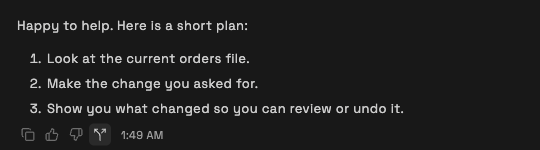

When an answer is useful, you can copy it, ask about a passage, or start a separate conversation from it. Branching lets you explore another direction while keeping the original chat available. You can also check the conversation's usage or save the whole chat as a page to read in a browser.

Before you start, open a Rath chat with an answer. To run a slash command, type it in the message box and press Enter or select **Send**.

## Fork or clone a conversation

Choose a fork when you want to return to a particular point; choose a clone when you want a separate copy through the latest message. A fork includes the message you choose, but not later messages. Both open a separate chat and leave the original conversation in place.

1. To branch from an answer, point to it and select the fork icon. Its hover label is **Fork chat from here**. The new chat opens in another tab with that answer included.
2. Alternatively, send `/fork`. In **Fork from…**, choose a message from the list. The list shows a preview and whether it is a user or assistant message. Choosing a question starts the new chat at that question; choosing its answer includes the answer too.
3. To copy the conversation through its latest message instead, send `/clone`. Rath opens the separate chat without asking you to pick a message.
4. Continue in the new chat. Return to the original tab to see the earlier conversation and continue there.

For example, after asking “Suggest three approaches to this project,” fork from the answer and ask “Develop the first approach into a checklist.” Return to the original and fork again to explore the second. Or, after a longer discussion, use `/clone` and ask “Now adapt this plan for a smaller team.”

## Copy or discuss an answer

1. Point to an answer and select the copy icon, labelled **Copy** when you hover over it, then paste the answer where you need it. To copy the latest Rath message instead, send `/copy`; **Copied to clipboard.** confirms the action.
2. To discuss only a passage, select the text in the conversation, open its context menu, and choose **Ask Rath**. The passage appears quoted in the message box.
3. Add a question and send it. For example, select a recommendation and ask: “What assumptions does this depend on?” You can also choose **Copy** from the selection's context menu to copy just that passage.

## Check usage and save a readable copy

Send `/session` to see available usage information for the current chat. The notification may show total tokens, percentage of context used, and a dollar cost. Tokens are small pieces of text used to measure model usage; context is the material available to the model during the conversation. The figures shown depend on what information is available. The cost is a usage figure, not necessarily your bill; check your provider's billing for actual charges, especially when using a subscription.

To save the **whole chat** as HTML, a format a browser can display:

1. Send `/export`, or open the Command Palette and choose **Rath: Export Chat to HTML**.
2. In **Export Chat to HTML**, choose a name and location and save. Rath opens the saved page when the export succeeds.
3. Review the page before sharing it; the conversation may contain sensitive information. For JSON or Markdown copies, see [Find and export past chats](/rath-docs/history-and-export/).

<!-- SCREENSHOT: HTML export save dialog -->

## If it doesn't work

- **That needs the chat to be idle: wait for the current answer or press Stop.** Wait for Rath to finish, or select **Stop**, then retry `/fork` or `/clone`.
- **Nothing to fork yet.** means Rath found no message to branch from. Send a message and try again. **Couldn't fork the session.** means the branch could not be created; retry and consult [Troubleshooting](/rath-docs/troubleshooting/) if it persists.
- **Nothing to copy yet.** means there is no Rath answer to copy with `/copy`. Ask a question first. **No session stats available yet.** means there are no usage figures to show yet.
- **Couldn't export the chat.** means the export did not complete. Check that a chat is open and try again. Cancelling the save dialog creates no copy.

See also [Chatting](/rath-docs/chatting/), [Slash commands](/rath-docs/slash-commands/), and [Chats and sessions](/rath-docs/sessions/).
