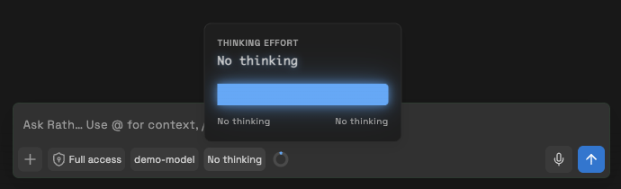

A model generates Rath's answers and decides what actions to take. Choose one for the work and account available to you; use the reasoning control to adjust how much effort a supported model spends on a request. A quick summary may need less effort than a difficult investigation. Results vary, so review the answer and changes regardless of the selection.

Before you start, open a Rath chat and connect a model provider using a subscription or API key. A provider is the company or service supplying the model. The list depends on the providers and access available to you; see [Providers](/rath-docs/provider-connections/) for help connecting one.

## Pick a model

1. When Rath is idle, open the model selector beneath the message box. Choose a model from the available list. The selected model appears in the control.
2. Open **Reasoning effort** and choose a level available for that model. Choices can include **No thinking**, **Minimal thinking**, **Low thinking**, **Medium thinking**, **High thinking**, **Extra-high thinking**, and **Maximum thinking**. Some models offer fewer choices; a model without reasoning support offers only **No thinking**. The available levels and their effect depend on the model and provider.
3. Type your request and select **Send**. The answer comes from the selected model. Changing the selection affects subsequent work; it does not rewrite an earlier answer.
4. To choose the starting model for new chats, open the Command Palette with `Command+Shift+P` on a Mac or `Ctrl+Shift+P` on Windows or Linux. Select **Rath: Choose Default Model…**, then pick from the available models. This choice is for new chats.

You can also use **Rath: Switch to Next Model** or **Rath: Switch to Previous Model** from the Command Palette while the chat tab is active. The commands wrap around the available models.

Which models you see depends on the providers you have connected. If you have not chosen a default, Rath selects an available model automatically; the starting model can therefore differ between accounts. Check the selector before sending a request. If your chosen default is no longer available, Rath falls back to another default.

Higher reasoning effort can take longer and may use more of a provider's allowance. Price, quotas and available models depend on the provider and plan; check your provider's terms before choosing.

## Try it

- For a straightforward task, start with an available model and a lower effort: “Summarize these meeting notes in five bullets.” Check that the summary preserves the decisions.
- For a task with several constraints, try a higher available effort: “Compare these three event plans against our budget and accessibility needs. Identify conflicts and explain the trade-offs.” Allow more time and check its evidence.
- If the result is incomplete, switch models after the turn finishes and ask: “Review your previous answer and identify anything it missed.” Compare both answers with the source material.

## If it doesn't work

If the model or permission control is dimmed while Rath works, its message is **Available again when the agent finishes**. Wait or stop the current work before changing it. **No models are available yet — configure a provider first.** means you need to connect a provider. If you see **Open a Rath chat first, then choose a default model.**, open a chat and repeat the command. **More than one model is needed to switch models.** means the next and previous commands need another available model. For connection and sign-in messages, see [Troubleshooting](/rath-docs/troubleshooting/). For tool access, see [Permission modes](/rath-docs/permissions/).
