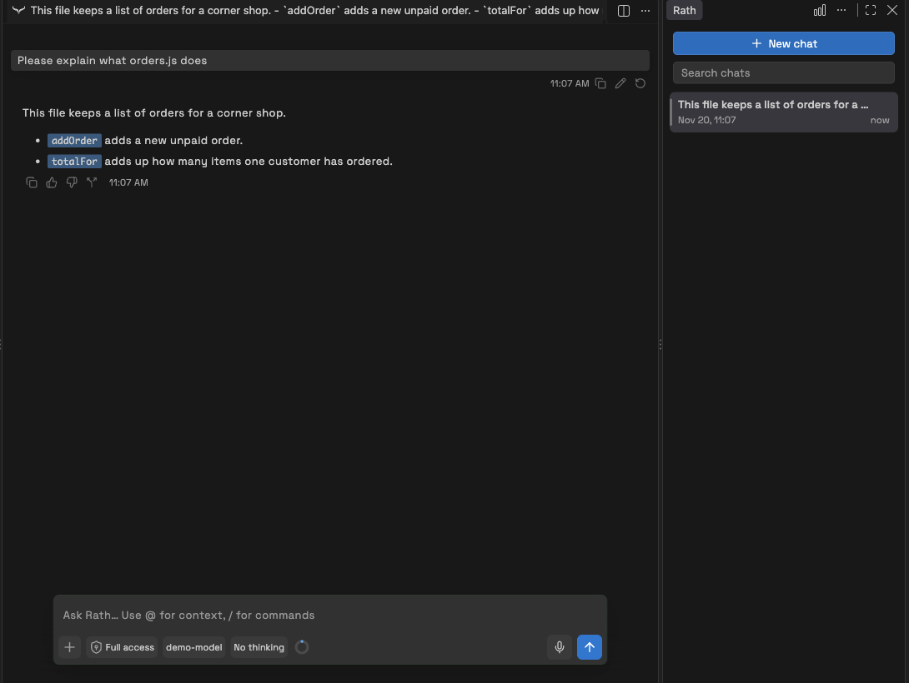

Use these commands to get back to a conversation, inspect recorded activity, choose a model for message suggestions, or share selected settings with Rath's terminal product. The Command Palette is a searchable list of actions: open it with Command+Shift+P on a Mac or Ctrl+Shift+P elsewhere, then type the command name and select it.

Before you start, open a Rath chat for the focus command, and open the folder associated with your chats for the graph. For suggestions, you need an API key for the selected suggestion provider; an API key is a credential that gives Rath access to that provider. See [Provider connections](/rath-docs/provider-connections/).

## Show the sidebar and return to a chat

1. Open the Command Palette and select **Rath: Toggle Rath Sidebar**. The Rath sessions sidebar appears. Run the same command again to hide it.
2. Open or select a chat, then work elsewhere in the window. To return to its message box, choose **Rath: Focus Chat Input** in the palette. You can also press Command+Shift+' on a Mac or Ctrl+Shift+' elsewhere.
3. The chat is brought into view and the cursor moves to its message box. Type a request such as “Summarize our discussion in three points” and select **Send**.

For example, hide the sidebar when you need more room to read, then show it again to find a conversation. After reading another document, use the focus command and ask: “What should I check next?”

## Inspect recorded activity

1. Open the folder containing the chats you want to investigate. Choose **Rath: Open Knowledge Graph** from the Command Palette, or select the graph icon in the Rath sessions view.
2. In **Rath: Knowledge Graph**, look at the dots and connecting lines. The legend identifies **Session**, **File**, **Edited**, **Read**, **Spawned**, and **Messaged**. A session is one conversation with Rath.
3. Select a dot or line to inspect its recorded messages or activity. Use **Close** to dismiss the detail. Check or clear **Messages**, **Tool calls**, **Tool results**, or **Thinking** to change what appears, and select **Refresh** to fetch the latest records.

For example, select a document dot to inspect recorded reads and edits, then return to chat and ask: “Which conversations worked on the project brief?” The graph reflects recorded activity; edits made outside Rath or through terminal commands may not appear. See [Finding out what happened across your chats](/rath-docs/session-graph/) for other ways to investigate.

<!-- SCREENSHOT: Knowledge graph with a selected item and its detail panel -->

## Choose suggestions for your message

Prompt suggestions continue text as you type in the chat box. They are off by default, and using them can incur provider charges. Their model is separate from the model answering your chat.

1. In settings, find the chat prompt suggestions option and enable it. Choose the suggestion provider there; the registered default is DeepSeek. Set an API key for that provider with **Rath: Set Provider API Key…**.
2. Choose **Rath: Choose Prompt Suggestion Model** from the palette. While the list loads, you see **Loading models for** the provider. Select a model under **Select a model for chat prompt suggestions**.
3. Alternatively, select **Enter model id manually…**, enter an ID supplied by your provider, and confirm. Return to a chat and begin typing; a suggestion can appear as faint continuation text. Review it before sending your message.

Choose a model that your provider offers and check its price and limits: suggestions make paid requests as you type. Selecting a model alone does not turn the feature on. You can disable the option in settings when you no longer want suggestions.

## Copy settings to the terminal product

If you also use Rath's terminal product, this command copies supported engine settings you personally set in Rath. It leaves unset settings to the terminal product and does not copy managed values.

1. Set the supported options you want in Rath first, then choose **Rath: Copy My Engine Settings to the Terminal Product**.
2. Review **Copy these engine settings to the terminal product?** and the displayed values. Select **Copy** to proceed, or cancel to leave them unchanged.
3. Look for **Copied. A terminal run now uses these engine settings.** Existing terminal settings are merged, and a backup is kept if there was already a settings file.

## If it doesn't work

- If focusing does nothing, open a Rath chat first and try again.
- **Open a folder first - the knowledge graph is scoped per workspace.** means you need the folder associated with the chats. **Nothing recorded yet. The graph fills in as sessions edit files, spawn sessions and message each other.** means there is no activity to draw yet. If you see **Could not load the knowledge graph.**, try **Refresh**.
- **No API key configured** for the suggestion provider means you should set its key. If the model list cannot be fetched or is empty, choose **Enter model id manually…** and use a valid ID from the provider. **Model id is required.** means the entry was blank. If a key was rejected, check it with your provider.
- **None of the engine settings has been set by you, so there is nothing to copy.** means there are no supported personal values to export. If Rath says the existing terminal settings are invalid or do not hold an object, it leaves them unchanged; correct them before trying again.

## Related pages

- [Chatting](/rath-docs/chatting/) covers sending and following up on messages.
- [Models and thinking level](/rath-docs/models/) explains the model used to answer in chat.
- [Command-line use](/rath-docs/command-line/) introduces the terminal product.
