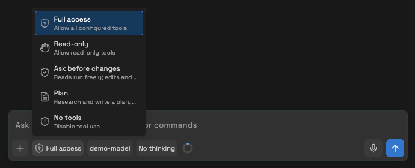

Choose a permission mode to control what Rath can do while helping you. Start with **Read-only** to investigate, use **Plan** to agree on an approach, or allow changes when you are ready.

Before you start, open the folder you want to work with and a Rath chat. The choices below are in the main chat; the [Agents Window](/rath-docs/agents-window/) offers **Read-only**, **Full access**, and **No tools**.

Even in **Read-only** and **Plan**, Rath can read your files and send relevant content to your selected model provider to answer you. Check that you are comfortable sharing the material before asking.

## Choose access for the task

1. While Rath is idle, open **Permission** beneath the message box. The current choice appears on the control; **Ask before changes** can appear as **Ask first**.
2. Choose the access that fits your task:

   | Mode | What Rath can do |
   | --- | --- |
   | **Read-only** | Read files and search, without editing or running commands. |
   | **Plan** | Read and search, then propose a plan without changing your work. Switch modes when you want Rath to carry it out. |
   | **Ask before changes** | Read and search without asking; request approval for edits and commands, with the exception below. |
   | **Full access** | Use configured tools, including editing files and running commands. Other feature settings still apply. |
   | **No tools** | Answer without using tools to inspect or change your work. |

3. Type your request and select **Send**. The selected mode remains visible beneath the message box. Rath's activity and answer appear in the conversation.
4. In **Ask before changes**, when **Allow Rath to use …?** appears, read the proposed action. Select **Allow** for that action or **Deny** to refuse it. **Always Allow … in This Chat** permits later uses of the same tool for the rest of the chat. For the shell tool, this includes later commands that could delete or change things.
5. Review changes before relying on them. See [Reviewing and undoing changes](/rath-docs/reviewing-changes/).

In **Ask before changes**, commands that only look at information can run without asking by default, as can reading and searching files. To require approval for those commands too, open Settings, search for `rath.agent.askMode.allowReadOnlyCommands`, and turn the setting off. Reading and searching files still do not require approval.

**Read-only** and **Plan** provide only reading and search tools, so features such as history search, memory, subagents, connected services, browser actions, and notifications are unavailable. In **Ask before changes**, connected services and browser actions also require **Full access**. Subagents can be asked to work with read-only access in this mode. See [Connect services](/rath-docs/mcp-servers/) and [Subagents](/rath-docs/subagents/) for their other requirements.

## Try it

- Choose **Read-only** and ask, “Summarize the documents in this folder and identify anything that needs my attention.” Expect an answer without edits.
- Choose **Plan** and ask, “Plan how to organize these notes by topic. Explain what you would change.” Read the plan before choosing whether to proceed.
- Choose **Ask before changes** and ask, “Fix the spelling in my meeting notes.” Review each approval request before allowing or denying it.

## If it doesn't work

If the permission control says **Available again when the agent finishes**, wait for the answer or select **Stop**, then change the mode. If Rath cannot edit, check whether **Read-only**, **Plan**, or **No tools** is selected. If you denied an action, tell Rath how you want to proceed; do not approve a request you do not understand.

Permissions are separate from the additional limits described in [Limit shell commands](/rath-docs/shell-safety/). For model access, see [Models and thinking level](/rath-docs/models/).
