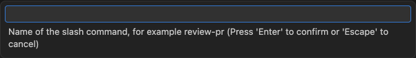

Save a **prompt** to repeat a request with a slash command. Make a **skill** for a procedure you want Rath to follow on suitable tasks. Use **project instructions** for guidance across new chats in one project, such as the tone for customer documents.

Before you start, [connect a provider](/rath-docs/provider-connections/) so you can test the result. Open a project folder if you want to share a prompt or skill with its users, or create project instructions. When Rath asks whether you trust a folder, trust it only if you trust its contents.

Open the Command Palette with Command+Shift+P on a Mac or Ctrl+Shift+P elsewhere, then search for the action named in each step.

## Make a reusable prompt

1. Choose **Rath: New Prompt (Slash Command)**. At **Name of the slash command, for example review-pr**, enter `brief`.
2. If asked **Where should it be saved?**, choose **This Project** to share it with people using the project, or **All My Projects** for your own use. With no project open, it is saved for your own projects.
3. In the starter, replace the description while keeping the surrounding lines. Replace the example instructions with `Summarize $ARGUMENTS in three short bullets for a new teammate.` Save your changes.
4. Start a new chat and send `/brief the project plan` at the beginning of the message. Rath substitutes `the project plan` for `$ARGUMENTS`. Provide the plan in the chat so Rath has material to summarize.

Look for three short bullets and check them against the plan. For separate values, use `$1` and `$2` in a prompt such as `Compare $1 with $2 in a table`. If you name it `compare`, send `/compare "first draft" "second draft"`; quotes keep each multiword value together.



## Make a skill

1. Choose **Rath: New Skill**. At **Name of the skill, for example release-notes**, enter `meeting-summary`.
2. If asked **Where should it be saved?**, choose **This Project** or **All My Projects**. The starter opens for editing.
3. Keep the opening lines and describe when to use the skill. For example, the beginning can look like this:

   ```text
   ---
   name: meeting-summary
   description: Summarize meeting notes and identify follow-up actions
   ---
   ```

   Below the heading, write: `Identify decisions, list action items with owners if stated, and flag unanswered questions. Do not invent owners.` Save your changes.
4. Start a new chat and send `/skill:meeting-summary Summarize the meeting notes I provide.` Include the notes or provide them in the chat. Skill commands are available by default; if they have been disabled, ask in plain language to use the meeting-summary skill instead.

Rath can also choose a relevant skill based on its description. Check the response against the notes, particularly the owners and decisions.

## Set guidance for a project

1. Open the project folder and choose **Rath: Open Project Instructions (AGENTS.md)**. AGENTS.md is the project instructions document shared with the project.
2. Edit the starter or existing instructions. For example, add `Write customer-facing text in plain English. Explain abbreviations on first use.` Save your changes.
3. Start a new chat in that project and ask: `Draft a short welcome message for a new customer.` Check the answer and refine the instructions if needed. Rath reads project instructions at the start of a chat; an untrusted project can prevent them from being loaded.

## If it doesn't work

- **Use lowercase letters, digits and hyphens only.** means the name contains an unsupported character. Try `meeting-summary` without spaces or capitals.
- **Open a folder first: project instructions live in it.** means you need to open a project folder and run the action again.
- An **already exists; opening it.** notice means Rath opened the existing item instead of replacing it. Edit it or choose another name.
- If a prompt or skill is missing, save your edits and start a new chat in the intended project. Check the folder's trust and make sure the skill has a nonempty `description` line.

See [Slash commands](/rath-docs/slash-commands/) for other chat actions, [Chatting](/rath-docs/chatting/) for sending material, and [Packages and plugins](/rath-docs/packages-and-plugins/) for additions made by others.
