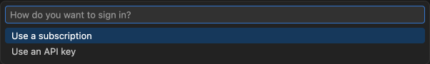

Connect Rath to a model provider, the service that supplies the AI model, before asking it to answer questions or work on a project. Depending on the provider, you can connect with an eligible subscription or an API key. Use a subscription when your account offers that sign-in option, or a key when your organisation provides one for API use. Charges and limits depend on your provider and plan.

## Before you start

Have your provider account ready. For an API-key connection, obtain a key from the provider or your organisation and keep it private. Open a folder and a Rath chat first; you can open a chat before connecting a provider. See [Getting started](/rath-docs/getting-started/) for those steps.

Your messages and material Rath reads to answer them are sent to the selected model provider. Choose a provider appropriate for the information you want to share.

Open the Command Palette with **Control+Shift+P** on Windows or Linux, or **Command+Shift+P** on macOS. Type the command name and select it from the list.

## Connect a subscription

1. In the Command Palette, choose **Rath: Set Provider API Key…**.
2. Choose **Use a subscription**. At **Select a subscription to sign in with**, choose your provider.
3. Follow the provider's sign-in prompts and complete any requested authorization.
4. Return to the chat. Select an available model from that provider and send “Summarize this project in three sentences.”

Rath displays **Signed in.** after a successful sign-in. If the model is available and the connection works, Rath responds in the chat. Available choices depend on your account and provider.

## Connect with an API key

1. In the Command Palette, choose **Rath: Set Provider API Key…**.
2. Choose **Use an API key**, then select your provider.
3. At **Set Rath API Key**, enter the key.
4. Select a model from that provider in your chat and try “Explain this document in plain language.”

Rath stores API keys encrypted in its secret storage. Subscription credentials are stored separately in a local credentials file. Removing one kind of connection does not remove the other.

## Change or remove a connection

To replace an API key, run **Rath: Set Provider API Key…** again and choose the provider. To remove a key, choose **Rath: Clear Provider API Key…** and select the configured provider.

To disconnect a subscription, open a chat, choose **Rath: Sign Out of a Subscription…**, and select the provider. Rath displays **Signed out of {provider}.** To switch accounts, sign out and connect the new account. Select its model and ask “What are the main decisions in these notes?” to check that it responds.

## If it doesn't work

- **No active Rath chat to sign in through — open a chat first.** Open a chat and repeat subscription sign-in or sign-out.
- **No subscription providers are available.** Check your provider access or use an available API-key connection.
- **API key is required.** Enter a nonempty key. If a provider rejects it, check the key and your provider account before replacing it.
- **No API keys are configured yet.** There is no saved key to clear. **No providers signed in** means there is no subscription to sign out of.
- **Your Claude plan doesn't cover Rath.** Check extra usage in your Claude account, connect with an API key, or choose another provider's model. Check the provider's current terms and charges before enabling extra usage.
- If a model says its provider is not signed in, connect that provider or choose another available model.

See [Models and thinking level](/rath-docs/models/) and [Troubleshooting](/rath-docs/troubleshooting/).
