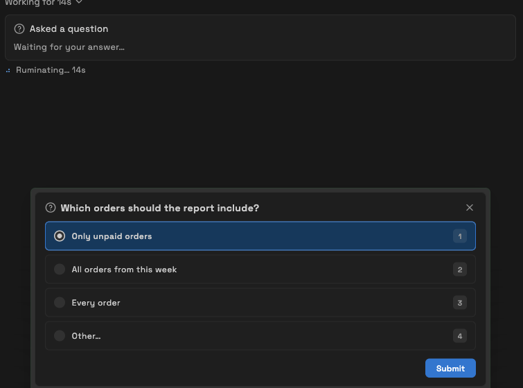

Rath can pause a task to ask for a decision or missing detail. Answering helps it continue with your preferences; an approval lets you decide whether it may take a particular action. You can also skip a question when you do not want to answer.

Before you start, open a Rath chat and send a request. A question appears above the message box when Rath needs your input; you do not have to open a separate screen.

## Answer a question

1. Read the question above the message box. If choices appear, read them before acting: a single-choice question starts with its first choice selected. A question that allows several choices starts with none selected.
2. Select the choice you want, or select several if the question uses checkboxes. To give a different answer, select **Other…** when it is offered, then type in the message box where you see **Type your own answer…**. You can also attach material to that answer.
3. If there are no choices, type your answer in the message box. It may show **Type your answer…**.
4. Select **Submit** for a choice, or send your typed answer. Selecting a choice alone does not submit it; pressing Enter on a focused choice does.
5. If you see **Question 1 of 2** or another count, use **Next** to move through the questions. Use **Previous** or the question tabs to revisit an answer before selecting **Submit** on the last question.

When your answer is submitted, the question controls close and Rath can continue. In the conversation, an answered choice question can show the offered choices with your selection marked. Check the subsequent response to see how Rath used your answer.

## Approve an action

**Allow is selected when an approval appears.** Pressing Enter on that choice or selecting **Submit** approves the action, so read the details and check the selection first.

In **Ask before changes** mode, Rath may show **Allow Rath to use …?** with details of an action. Reading tools do not ask for approval. By default, commands that only look at information also run without asking; you can change this in Settings by searching for `rath.agent.askMode.allowReadOnlyCommands`. A command is an instruction run on your computer.

1. Select **Allow** to allow this action, or **Deny** to refuse it. To permit later uses of the same tool in this chat as well, select **Always Allow … in This Chat**. For the command tool, this permits later commands too, not just the one shown.
2. Select **Submit**. Rath receives your decision and can continue.

To dismiss an individual question, use the X labelled **Skip this question**, or press Escape while the question has focus. For a group of questions, the X is labelled **Cancel**: the remaining questions are cancelled. Skipping an approval refuses that action; it does not grant permission.

## Try it

- Ask, “Help me organize these meeting notes. Ask me which topics matter most before you begin.” If Rath offers choices, select the topics you want and submit them.
- Ask, “Draft a welcome message. Ask me about the audience and tone first.” Use **Other…** if a suggested tone does not fit, and type, “Friendly and concise, for new volunteers.”
- In **Ask before changes**, ask, “Fix the spelling in my meeting notes.” If an approval appears, review the proposed action and choose **Allow** or **Deny** before submitting.

## If it doesn't work

- If the message box says **Choose an option above**, select a choice first. Select **Other…** to enable a typed answer when it is available; approval questions do not offer it.
- If **Other…** is selected but submitting does nothing, enter an answer or add an attachment. An empty multiple-choice selection is different: it can be submitted as **None selected**.
- If you see **Waiting for your answer…**, look for the question above the message box. If you skipped a question, the conversation can show **Cancelled** or **Remaining question(s) were cancelled.** Tell Rath what you want in a new message if you still need the task done.

For more control over actions, see [Permission modes](/rath-docs/permissions/). For sending messages and attachments, see [Chatting with Rath](/rath-docs/chatting/).
