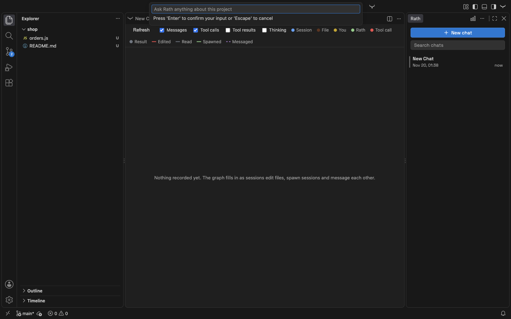

> Early: These commands are new and have not yet been verified in a Rath window.

Use **Quick Ask** when a question deserves its own conversation: type a short request and Rath opens a new chat with that request already sent. Use the model-switching commands when you want to move through the models available to an open chat without opening the model list.

Before you start, connect a model provider, the service that supplies Rath's models. To switch models, have at least two available and open the Rath chat you want to change. See [Getting started](/rath-docs/getting-started/) and [Models and thinking level](/rath-docs/models/). The Command Palette is the searchable list of commands you can open with Command+Shift+P on a Mac or Ctrl+Shift+P elsewhere.

## Start a separate question

1. Open the Command Palette and select **Rath: Quick Ask**. You can also select **Quick Ask** in the Rath view title.
2. In the box showing **Ask Rath anything about this project**, type your question. For example: “Summarize this project for a new teammate in five bullets.”
3. Press Enter. Rath opens a new chat, displays your question as its first message, and starts the request. Continue in that chat if you have follow-up questions.

For another fresh conversation, try **Rath: Quick Ask** again with “Explain the main purpose of this project in plain language.” Each non-empty request starts a new chat; it does not add the question to the conversation you were reading. Cancel the box or leave it blank if you change your mind.

## Move between models

1. Select the Rath chat tab you want to use and wait until its current work finishes.
2. Open the Command Palette and select **Rath: Switch to Next Model**. To move in the other direction, select **Rath: Switch to Previous Model**.
3. Check the model control beneath the message box to see the selection. Repeat the command to move through the available list. At either end, the next step wraps around to the other end. If the current model is not in the list, either command chooses the first available model.
4. Send your next request in that chat. For example: “Review your previous answer and identify anything it missed.” Compare the answer with your source material. Switching affects subsequent work; it does not replace an earlier answer.

Different providers and plans offer different models, prices, allowances, and response speeds. Check the model name and your provider's terms before sending a costly or lengthy request. For a specific model or thinking level, use the controls described in [Models and thinking level](/rath-docs/models/).

## If it doesn't work

- **Open a Rath chat first.** means the active tab is not a usable Rath chat. Select an open Rath chat and run the model command again.
- **Available again when the agent finishes** means the chat is working. Wait for the response to finish, or stop the work, then try switching again.
- **More than one model is needed to switch models.** means the available list is too short. Check your provider connection and available models before retrying.
- A switch may report that a provider is not signed in, or **Could not switch to** the chosen model. If the message names the model Rath is staying on, the switch did not take effect. Sign in or add the provider's key if requested; otherwise retry or choose another model. See [Provider connections](/rath-docs/provider-connections/).
- If a request reports **The message was not sent: Rath is not connected. Use Retry, then send it again.**, select **Retry** and resend it. See [Troubleshooting](/rath-docs/troubleshooting/).

## Related pages

- [Chatting](/rath-docs/chatting/) explains follow-ups and stopping work.
- [Models and thinking level](/rath-docs/models/) covers choosing a model and reasoning effort.
- [Provider connections](/rath-docs/provider-connections/) covers access to models.
