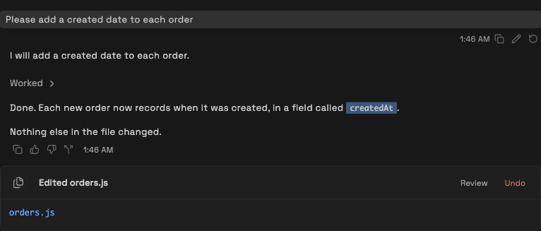

After Rath edits your work, review what changed before relying on it. You can keep the result, undo the edits from one response, or reverse the latest recorded change or all recorded changes in the current chat.

**Before you start:** Open the chat in which Rath made the edits. The review card and revert actions depend on Rath having a record of the changes. A change may already have been applied by the time you review it.

## See and keep a change

1. Find the card in Rath's response labelled **Edited** followed by a file name or a number of files.
2. Select a file name to open its comparison, or select **Review** to review the files from that response together. A comparison, sometimes called a diff, shows the earlier content alongside the current content.
3. Read the additions and removals and check that they do what you asked. You can also hover over a file name for a preview.
4. If you want to keep the result, leave the edits in place. The edits represented by this card have already been applied; the card's controls are **Review** and **Undo**.

You should see the comparison open for the selected file or files. An older response's comparison can include later changes to the same file, because it compares against the current content. Read it with that in mind.

## Undo a response or a session

1. To undo the recorded edits from one response, select **Undo** on its edited-files card. Read the confirmation and select **Revert All** to proceed.
2. To undo only the most recent recorded edit in the chat, open the **+** menu beside the message box and select **Revert last change**. The confirmation names the file; select **Revert**.
3. To undo all recorded edits in this chat, open **+**, select **Revert all changes**, read the count and confirmation, then select **Revert All**.
4. Open the affected files and check the result. Rath reverses recorded edits newest first. If it reaches a change it cannot reverse, it stops; earlier changes remain. A newly created file can be removed when reversing its creation leaves it empty.

**Revert last change** means the last recorded edit, which can be one of several edits in a response. **Undo** on a card covers that response's recorded edits; **Revert all changes** covers the current chat's recorded edits. These controls are not a general undo for everything Rath did: they use recorded file edits, so do not assume they reverse command effects or changes without a record. For example, a large file write may not have a record that these controls can reverse.

## Try it

- For a small change, ask: “Change the heading in my document to ‘Welcome’.” Open the edited file's comparison and leave it in place if the wording is right.
- For a broader revision, ask: “Make the introduction shorter and fix its spelling.” Review the files, then use the card's **Undo** if you prefer the earlier version.
- After several requests, use **Revert last change** if only the latest recorded edit is unwanted. Use **Revert all changes** only when you intend to reverse the chat's recorded edits, including earlier ones.

## If it doesn't work

- If the revert menu choices are disabled, there may be no recorded edits, or older chat history may still be loading. Wait for the history to finish and check again.
- **Couldn't revert** followed by a file name can mean the file no longer matches the recorded change. Rath says nothing was changed for that edit. Inspect the file and decide how to restore the content you want; do not assume a retry will restore it.
- **Reverted … of … change(s)** means a bulk revert stopped partway through. Check the files: newer changes may already have been reversed, while earlier ones were left alone.
- A preview can say **No diff preview available** because the file no longer exists, the change is no longer tracked, or the file changed too much to reconstruct it. A missing file can also produce **Can't show a diff**. Check the current file and the chat before deciding what to do.

## Related pages

- [Chatting with Rath](/rath-docs/chatting/)
- [Permissions](/rath-docs/permissions/)
- [Sessions](/rath-docs/sessions/)
