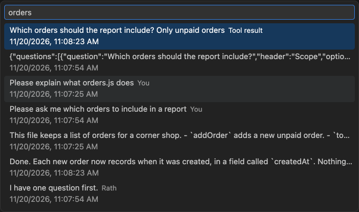

When a decision or piece of work is buried in another chat, ask Rath to search your history or trace recorded activity. This can help you recover the reason for a decision, find chats that worked on a document, or understand a long conversation.

## Before you start

Open the folder associated with the earlier chats and connect a provider. History searches cover chats associated with the open workspace: the folder or group of folders open in Rath. Rath stores a searchable index of chat history on your computer. Consider whether past messages contain sensitive information before asking Rath to use them in an answer.

To ask Rath to investigate, choose **Full access** under **Permission**. This also allows other configured tools, including tools that can change files and run commands; see [Permissions](/rath-docs/permissions/) before choosing it. **Read-only**, **Plan**, and **No tools** do not provide the history tools. The **Find abilities when needed** feature is on by default; changes to it apply to new chats.

## Ask Rath to investigate

1. Open a chat in the relevant folder, select **Full access**, and type a specific question.
2. Select **Send**. For example: “Search our past chats for the decision about the launch date. Tell me what was decided and which chat said it.”
3. Read the answer. Ask “What was said immediately before and after that decision?” if you need more context.
4. Check the original chat when the detail matters. Ask Rath to identify it, then use message search to open it.

Rath can search messages from open and closed chats, inspect nearby recorded messages, and trace recorded activity across chats. It can narrow a search by time, sender, document, activity, or failures. Try one of these requests:

- “Which chats worked on the project brief, and what did they say about the intended audience?”
- “Show me a timeline of recorded work on the launch plan yesterday, including any errors.”
- “Give me a guide to this chat: what documents were recently edited, what errors occurred, and what did we discuss most recently?”

The guide describes the current chat; search history to investigate another one. If a timeline is cut short, ask for a narrower time period. Answers are generated by Rath, so check important interpretations against the original messages.

Records have limits. Edits made through terminal commands or outside Rath are not captured as document edits in the recorded activity. An empty result means no matching activity was recorded, not that nothing happened. Results also depend on the words and filters used.

## Find a message yourself

You can search without asking Rath to use a history tool:

1. Open the Command Palette and choose **Rath: Search Message History…**.
2. In **Search everything said across every Rath session in this workspace…**, type a phrase such as `launch date`. Results update as you type.
3. Read the preview and select a result to open its chat. Rath tries to move to matching visible message text; a thinking or tool result opens the chat without moving to its raw text.

## If it doesn't work

- **Open a folder first — message history is scoped per workspace.** Open the folder associated with the earlier chats and search again.
- **Message search failed: …** or **Could not open that chat: …** includes more detail. Read it and try again. **That chat could not be found any more. It may have been deleted.** means that result cannot be opened; try another result.
- If Rath cannot investigate history, check **Permission** and use **Full access**. Check **Find abilities when needed** under **Rath Features** and start a new chat after changing it. If there are no matches, try different words or a broader time period.

See also [Find and export past chats](/rath-docs/history-and-export/), [Chats and sessions](/rath-docs/sessions/), and [Chatting](/rath-docs/chatting/).
