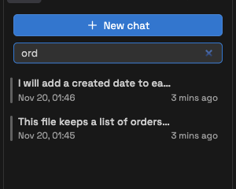

Use separate chats to keep different tasks easy to find. You can return to earlier messages, give each chat a useful name, or remove it when you no longer need it.

Before you start, open the folder you want to work in. Select **Toggle Rath Sidebar** in the top bar to show the chat list. Previous chats in the list belong to the current workspace. To send a message, you also need a working model connection; see [Getting started](/rath-docs/getting-started/).

## Start and switch between chats

1. In the chat list, select **New chat**. A chat opens in a tab.
2. Type your request and send it. For example: “Summarize the documents in this folder in plain language.”
3. For a different task, select **New chat** again. For example, ask: “Suggest a checklist for reviewing these documents.”
4. Select either chat's tab or its row in the list to return to it. Each chat has its own messages; you can have more than one chat working at a time.

For a quick question, choose **Rath: Quick Ask** from the Command Palette or **Quick Ask** from the chat list menu. Type your question and press Enter to start a new chat with that question. Press Escape to cancel.

Open chats appear above previous chats in the list. A small bar at the left of a row marks an open chat; the selected chat is highlighted. A new chat can initially say **New Chat** while its title is being established.

## Find, reopen, and rename

1. To narrow the list, type part of a chat's title in **Search chats**. Clear the search to see the whole list again. This search filters the list; it is not a search through every message.
2. Select a previous chat to reopen it. Its conversation opens in a tab, and its row moves into the open chats at the top. You can continue by typing, for example, “Turn your earlier summary into five action points.”
3. To make a chat easier to find later, point to its row and select **Rename**. In **Rename Chat**, enter a name such as “Document review” and press Enter. The new title appears in the list and, for an open chat, on its tab.

## Close or delete

To finish with an open chat for now, close its tab or select **Close** beside its row. Closing the last tab stops that chat, including any response still in progress. Wait for the result before closing if you need it. You can reopen a saved chat from the list; changes already made to your files are not undone by closing it.

To permanently remove a saved chat:

1. Close it first if it is open, then find its row in the list.
2. Select **Delete** beside the row.
3. Read the confirmation, **Delete "…"?**, and select **Delete** to proceed. The chat disappears from the list. The confirmation warns that this permanently deletes the chat and cannot be undone.

## Notice work in another chat

When a chat finishes a response while you are looking elsewhere, a dot appears after its title in the list. Select the chat to see the result and clear the marker. Rath also shows a notification saying **"…" has finished.** This completion notification is on by default and can be turned off in Settings; see [Notifications](/rath-docs/notifications/). Select **Go to Session** in the notification to open that chat. If a background chat is waiting for your input, its row can also gain a dot and a notification offers **Go to Session**.

## If it doesn't work

- **No chats match your search.** Clear or shorten **Search chats** and check the title.
- **No previous chats found for this workspace.** Check that you opened the folder associated with the conversation. An empty new chat may not yet have a saved history.
- **Name is required.** Enter a nonempty name. If Rath says **Couldn't rename this chat — no chat session is currently running to make the change.**, reopen the chat and try again.
- **This chat could not be opened** means its earlier messages cannot be read. Choose **New Chat** to continue working in a new conversation.
- **Couldn't delete "…"** means the deletion failed; check the accompanying detail and try again. A row showing **Connecting…** is still connecting; **This chat needs attention.** indicates a problem worth opening the chat to inspect.

See also [Chatting](/rath-docs/chatting/), [Questions and answers](/rath-docs/questions/), and [Troubleshooting](/rath-docs/troubleshooting/).
