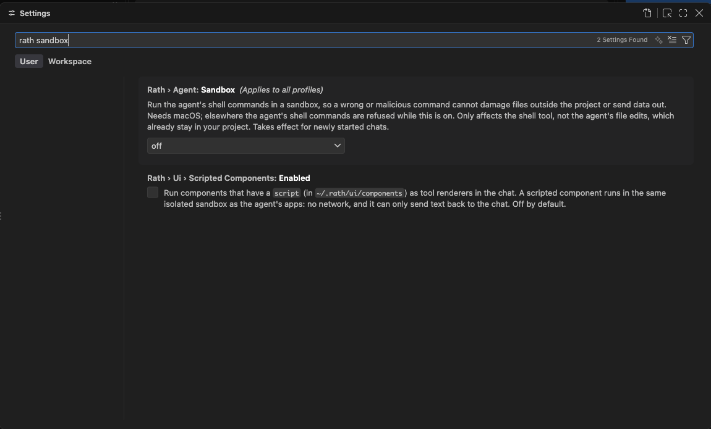

Use the shell sandbox when you want extra limits on commands Rath runs while working for you. A shell command is an instruction to your computer, such as running a test or downloading a package. The sandbox can limit where those commands write, and can also block their network access.

Before you start, open the folder you want Rath to work in and choose a [permission mode](/rath-docs/permissions/) that allows commands. The sandbox adds limits to those permissions. The restricted choices require macOS; Rath has no shell sandbox on Windows or Linux.

## Choose a limit

1. Open **Settings** and search for `rath.agent.sandbox` to find the sandbox setting.
2. Choose one of the following values in the setting:
   - **off** is the default. Shell commands run with your full access, including the ability to write outside the project and use the network.
   - **files** allows shell commands to write inside the project folder and temporary folders. Choose it when work needs commands but should keep their writes within those areas. Network access remains available.
   - **files-and-network** adds a network block to the same write limits. Choose it for work that can be done without downloading or sending data. Commands that need the network, such as downloading packages or sending changes to a remote repository, will fail.
3. Select **New Chat** to start a new conversation. The chosen setting takes effect in newly started chats; an existing chat does not pick up the change.
4. Ask Rath to do the task and send your message. If you use **Ask before changes**, review any proposed command that asks for your approval. By default, commands recognized as only looking run without asking. Watch the chat for the result and Rath's answer.

When it works, the setting shows your selected value and the new chat can run permitted commands. A command that tries a blocked operation can fail instead of completing that operation. Check the result before assuming the task succeeded.

These limits apply to Rath's shell commands, not its ordinary file edits. They do not make a chat read-only. The sandbox does not stop commands from reading files you can read, including private files outside the project. With **files**, a command can also send information over the network. To control whether Rath can edit or run commands at all, use the separate **Permission** control.

## Try it

- To check your work, ask: “Run the project's tests and explain any failures.” With **files-and-network**, tests that need a network connection can fail.
- To prepare a project for work, ask: “Install the project's dependencies, then tell me what happened.” If dependencies need downloading, use **files** to allow network access while limiting writes.
- To inspect the current work, ask: “Show me the current changes and summarize them.” In **Ask before changes**, a recognized look-only command can run without a prompt.

## If it doesn't work

If the message begins **The shell sandbox is turned on, but this machine cannot provide it (it needs macOS)**, Rath has refused the command because the protection is unavailable. Use a supported Mac, or choose **off** and start a new chat only if you accept commands running with your full access.

If a command fails, read its output and ask Rath to explain it. A failure can have causes other than the sandbox. For a blocked download, check for **files-and-network**; for a blocked write, check whether the destination is outside the project and temporary folders. Change the setting only if the task needs broader access, then start a new chat and try again.

For approval choices, see [Permission modes](/rath-docs/permissions/). For reviewing edits, see [Reviewing and undoing changes](/rath-docs/reviewing-changes/); for other failures, see [Troubleshooting](/rath-docs/troubleshooting/).
