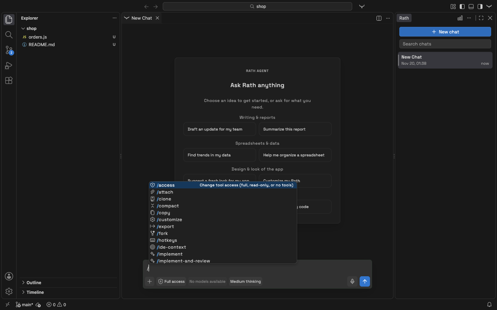

Slash commands give you a short way to change a chat setting, find another conversation, or act on the current one. For example, use `/access` before asking Rath to inspect material, or `/copy` after an answer you want to paste elsewhere.

Before you start, open a Rath chat. Some commands need an existing conversation, and actions that change its history need Rath to finish its current answer first.

## Run a command

1. At the very start of the message box, type `/`. Rath can show a list of commands and descriptions. Type more letters to narrow the choices.
2. Use the arrow keys and press Tab or Enter to insert a choice, or type the command yourself. Accepting a suggestion inserts it; it does not run it yet.
3. Press Enter or select **Send** to run the command. For commands that offer a choice, select the item you want. The command is an action, so type your next question separately.

For example, send `/access`, select **Read-only**, then ask: “Summarize the project without changing anything.” Or send `/model`, choose an available model, and ask: “Explain this proposal in plain language.” The selected control reflects your choice. See [Permissions](/rath-docs/permissions/) and [Models and thinking level](/rath-docs/models/) for the trade-offs.

## Choose settings and material

- `/access` opens the tool-access choices: **Full access**, **Read-only**, **Ask before changes**, **Plan**, and **No tools**. You can select them directly with `/access full`, `/access read-only`, `/access ask`, `/access plan`, or `/access no-tools`. When a change succeeds, Rath reports, for example, **Tool access set to Read-only.** See [Permissions](/rath-docs/permissions/) before choosing.
- `/attach` opens a file picker so you can add material to your next message. For example, attach a proposal and ask: “Summarize the main decisions in this document.”
- `/model` opens the model selector. You can follow it with an available model's exact name to select it directly.
- `/thinking` opens **Reasoning effort**; `/thinking high` selects **High thinking** when that level is available for the model.
- `/ide-context` toggles whether the active editor's file and selection are included with the next message. Use `/ide-context on` or `/ide-context off` to set it explicitly. Rath reports whether it will be included.
- `/compact` condenses the conversation context, the material Rath uses to continue the chat. Rath reports **Context compacted.**, sometimes followed by a summary. See [Context](/rath-docs/context/).

## Work with conversations

- `/new` opens a new chat. `/resume` offers **Resume a session** so you can choose an earlier one.
- `/name` asks for a **Session name**. You can also send `/name Marketing ideas` to name it directly.
- `/session` shows available usage information, such as context used and cost.
- `/fork` offers **Fork from…** so you can choose an earlier message as the starting point of a new conversation. `/clone` duplicates the conversation at its current position. See [Sessions](/rath-docs/sessions/).
- `/copy` copies the last Rath message and reports **Copied to clipboard.** For example, ask “Draft a short project update,” then send `/copy` and paste the answer into your notes.
- `/export` opens the save flow for an HTML copy of the chat. `/quit` closes the chat tab; if Rath is answering, closing the last tab for that chat interrupts the answer. See [History and export](/rath-docs/history-and-export/).

## Open controls

`/login` opens provider sign-in; `/logout` opens the provider sign-out flow. `/settings` opens Rath settings, `/hotkeys` opens keyboard shortcuts, and `/trust` opens workspace trust controls. See [Provider connections](/rath-docs/provider-connections/).

`/customize` starts a request to change Rath's appearance, or offers to turn on Agent Customization first. After changing extensions, prompts, or skills, wait for Rath to finish answering and send `/reload` to reconnect the current chat. Rath reports **Reconnected — extensions, prompts, and skills reloaded.**

Additional suggestions can come from installed extensions, prompts, or skills. Their names and effects depend on what is available in your setup; read the description shown in the list before using one.

## If it doesn't work

- **That needs the chat to be idle: wait for the current answer or press Stop.** Wait for the answer or select **Stop**, then send the command again.
- **That needs an open chat: start a new chat first.** Open a chat and try again. If suggestions do not appear, start `/` at the beginning of the message box.
- **Nothing to copy yet.** means there is no Rath message to copy; ask a question first. **Nothing to fork yet.** means there is no earlier message to branch from.
- **Couldn't compact the context.**, **Couldn't fork the session.**, or **Couldn't export the chat.** means the requested action did not complete. Try again and see [Troubleshooting](/rath-docs/troubleshooting/) if the problem persists.

For ordinary messages and the attachment menu, see [Chatting](/rath-docs/chatting/).
