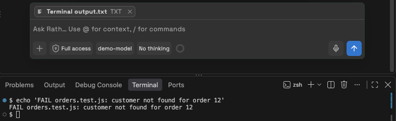

Give Rath a snapshot of a terminal result, a passage open in your editor, or a picture when words alone would leave out useful detail. Share an error to understand it, select a passage to have it explained, or attach a screenshot to discuss a screen. Check the material for passwords or other private information before sending it.

## Before you start

Open a Rath chat with a connected provider. A terminal is a window where commands run and print results; an editor is where you view and change text or code. Open the terminal, editor, or picture relevant to your question. When you send, the material is shared with your selected provider. The plus button beside the message box is called **Attach, context, and session actions**.

## Share terminal output

1. If you have more than one terminal, select the terminal containing the result you want Rath to see in the terminal list. Check its output for private information.
2. In the chat, select **Attach, context, and session actions**, then **Attach terminal output**.
3. A **Terminal output.txt** attachment appears by the message box. Select it to inspect the captured text; use **Remove** if it is the wrong output.
4. Type your question and select **Send**. Your message and attachment appear in the conversation, and Rath can respond to the captured output.

The attachment captures up to the last 150 lines of the active terminal at the time you attach it. When sent, its text is limited to 6,000 characters, so a long capture can be shortened. Inspect the attachment before sending to check that you selected the intended terminal and that it contains no secrets. If the relevant result is older or too long, share a suitable text extract instead. For example, ask: “Explain this error in plain language and suggest what I should check first.” If the terminal output changes afterwards, attach it again to share the newer result.

For shortcuts that start an explanation or a fix directly from the terminal, see [Help with project changes and terminal output](/rath-docs/workflow-helpers/).

## Share an editor selection

1. Open the relevant text in the editor and highlight the passage you want Rath to discuss.
2. Open **Attach, context, and session actions** and select **IDE context**. Reopen the menu to check that it has a check mark. An indicator beside the composer says **Including the active file and selection with your next message**.
3. Type a request such as “Explain the selected passage to someone new to this project” and select **Send**. Rath receives the active editor's selection with your question.
4. To stop including editor context in later messages, open the plus menu and select **IDE context** again; the check mark disappears.

Rath gathers editor context when you send, even though it is not shown in your message bubble. It includes the active file's name and location, its language, and the selected text. If there is no selection, it uses visible text instead. It also includes up to 20 reported issues for that file, if there are any. The selected or visible text is limited to 6,000 characters; longer text is shortened. Select the most relevant passage, check it and the file's reported issues for private information, and check the answer against the original. If you switch editors before sending, check which editor and selection are active.

## Share a picture

1. Select **Attach, context, and session actions**, then **Attach a file (image or text)**.
2. Choose your picture. A picture attachment appears by the message box. Select it to preview it, or select **Remove** to take it out before sending.
3. Add a request and select **Send**. For example: “Describe this screen and suggest three ways to make the instructions clearer.” Review Rath's response against the picture.

Picture files can be PNG, JPEG, GIF, WebP or BMP and must be no larger than 8 MB. The same picker accepts plain-text files. For other ways to share material, see [Context](/rath-docs/context/).

## If it doesn't work

- **The active terminal has no output to attach.** Select the terminal containing output and try again. Check that the attachment appears before sending.
- If editor context is missing or describes the wrong text, open the intended editor, select the passage again, and check that **IDE context** is marked before sending. Without an active text editor there is no editor context to gather.
- A picture over the limit produces **[name] is larger than 8MB and can't be attached.** Use a smaller picture. **Couldn't read [name].** means Rath could not read the chosen file; check that it is accessible and choose it again.
- If the message itself is not sent because Rath is disconnected, use **Retry** and send again; see [Troubleshooting](/rath-docs/troubleshooting/).

See also [Chatting](/rath-docs/chatting/), [Context](/rath-docs/context/) and [Permission modes](/rath-docs/permissions/).
