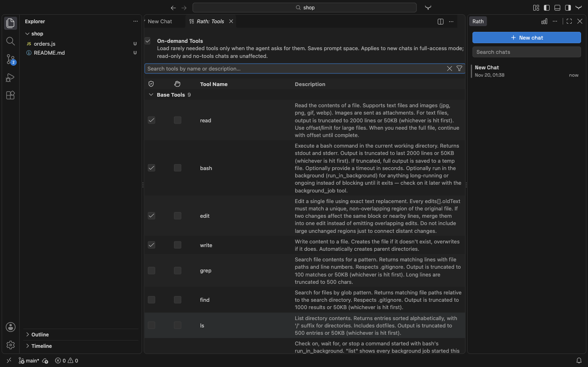

> This feature is new; if something behaves differently from this page, tell us.

Tools let Rath take actions, such as searching or working with your project. Use the Tools screen to find an action, switch it on or off, or request confirmation before it runs. Availability also depends on the chat's permission mode: switching a tool on does not grant permissions that the mode withholds.

Before you start, open a Rath chat. To use tools from a connected service, set up that service first; see [MCP servers](/rath-docs/mcp-servers/).

## Find and change a tool

1. Open the command palette and choose **Rath: Manage Tools…**. The same list is also in settings under **AI > Tools**.
2. Wait for the list. It has **Tool Name** and **Description** columns and two checkbox columns. Hover over their icons to see **Enable** and **Ask User**.
3. Enter a name or word in **Search tools by name or description…**. Search also matches names and descriptions of individual actions within a tool. Use **Clear search** to restore the list.
4. To narrow the list by type, choose **Filter by category**, then **Base Tools**, **Extension Tools**, **MCP Tools**, or **IDE Tools**. Choose **All Categories** to see all sections again. Select a category's chevron to collapse or expand it; its count shows matching tools.
5. Clear a tool's **Enable** checkbox to switch it off, or select it to switch it on. To request approval before a supported tool runs, select its **Ask User** checkbox. Clear that checkbox to remove that individual request for confirmation.
6. Some rows expand into actions or subgroups. Use an individual checkbox for one action, or a subgroup checkbox for its members. If a whole subgroup is off, turn the subgroup back on before adjusting its individual rows.

The checkbox changes immediately. When Rath next needs an enabled, available tool, it may choose to use it; a checked box does not force it to do so. If confirmation applies, watch the chat for the request and read it before deciding. Hover over a shortened description to read it in full.

## Match tools to your permissions

For a chat where Rath should answer without tools, select **No tools** in the chat's permission selector. For inspection without changes, choose **Read-only**. To allow broader actions, choose **Full access**; it can read, edit files and run commands. The separate **Ask before changes** and **Plan** modes offer other choices; see [Permission modes](/rath-docs/permissions/) for their behavior.

A tool may appear in the list even when the current mode cannot use it. Connected MCP tools require **Full access** and an enabled service connection. A **Not configured** badge means further setup is needed. Enabling a tool does not configure its service or override the permission mode.

## Try these requests

- With **Read-only**, ask: “Read the project and explain what it does.” Check the answer against the project.
- Find a tool you want Rath to ask about, select **Ask User**, then request an appropriate task, such as “Find the project brief in my connected service.” If Rath chooses that tool, review its request before allowing it.
- To reduce available actions, clear **Enable** for a tool you do not want, then ask: “Summarize the information I have already provided.” Turn it back on later if needed. Read the on-demand limitation below first.

## What to know

**On-demand Tools** loads certain less frequently needed tools when Rath asks for them, saving space in the information sent to the model. It applies to new chats in **Full access**; read-only and no-tools chats are unaffected. The list marks the relevant tools **On demand**.

When this option is on, Rath's on-demand search can activate a listed on-demand tool even if you switched that tool off. If you need a tool to stay off, switch **On-demand Tools** off and start a new chat; use an appropriate permission mode as well. This guide is based on the implementation; the complete interaction has not been confirmed in a live Rath window.

## If it doesn't work

- **Open a Rath session to manage its tools.** Open a chat and return to the screen. **Loading tools…** or **Refreshing…** can appear while the list loads.
- **Couldn't load the current tool list** is followed by an error. Check that error and try opening the screen again. A previously loaded list may remain visible when the current list could not be fetched.
- If you cannot find a tool, clear the search, choose **All Categories**, and expand its section. **No MCP tools registered yet — connect an MCP server to add some.** can appear under **MCP Tools**; check the connection and permission mode using the [MCP guide](/rath-docs/mcp-servers/).
- If a checkbox is unavailable, hover for its explanation. **Confirmation doesn't apply to this tool.** means its **Ask User** control cannot be used. An action may instead say to enable its parent tool first.

See also [Permission modes](/rath-docs/permissions/), [MCP servers](/rath-docs/mcp-servers/) and [Settings: Tools](/rath-docs/settings-tools/).
