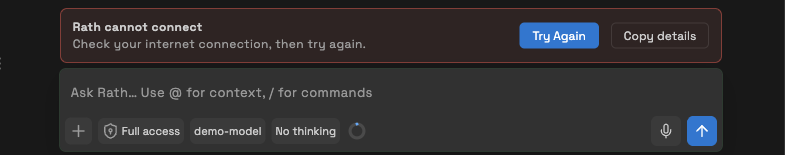

Use this page to get a stalled chat moving again, resolve a connection problem, or collect details for someone helping you.

## Before you start

Keep the chat open so you can read its message and copy any available details. A retry may repeat work, so inspect changes already made before asking again.

## Find the message and act

1. Read the message in the conversation or connection screen. If details are available, use **Copy details** to preserve them for someone helping you; check the copied text for private information before sharing it.
2. Match the message to a case below and follow its suggested action.
3. If a retry succeeds, the conversation continues. Check the answer and any changed material. If it does not, keep the exact message and ask the person who provides Rath or your model provider for help, as appropriate.

### Waiting or stopped

**Still waiting for the model** can mean the model is taking time to think. By default, it appears after 15 seconds without a reply; after 30 seconds Rath offers actions. These times change if the waiting notice setting has been changed. If Rath adds **It may be stuck. You can ask again or stop here.**, choose **Retry** to ask again or **Stop** to stop. During an automatic retry, you may see **The model did not answer, so it is being asked again.** and a try count. The model, permission and reasoning controls become available again after the current work ends.

**The chat stopped unexpectedly** suggests trying again to reconnect. **The answer could not be completed** suggests asking again; if it keeps happening, choose another model. **Something went wrong** suggests trying again and starting a new chat if the problem persists.

### Account, connection and limits

**Sign in to continue** means Rath needs access to the selected model. Connect the provider or add its key, then try again. **Sign-in failed:** is followed by the provider's error; read that detail and check the account or try signing in again. **No active Rath chat to sign in through — open a chat first.** tells you to open a chat before signing in.

**Your Claude plan doesn't cover Rath** points to a Claude extra-usage issue. Check your Claude account’s usage settings and current billing terms. Rath suggests adding extra usage, choosing **Add your key** to use an API key, or picking another model. Check the provider’s charges before choosing.

**Too many requests right now** means wait a moment and try again. The underlying problem can also be a provider limit or low balance, so check your provider account if it continues. **Rath cannot connect** suggests checking your internet connection before trying again. **Rath could not start** suggests checking connection and settings; if it says to open a folder, open one first.

### Missing history and attachments

**This chat could not be opened** means its earlier messages cannot be read. Start a new chat to continue working. If a chat is simply missing from the list, first open the folder where you used it and search again.

**Couldn't read …** identifies an attachment Rath could not read; check the file and try again. **Couldn't compact the context.** means compaction failed; try again when the chat is idle or start a new chat. **Couldn't export the chat.** means no export was completed; try another destination.

## If it doesn’t work

If the same problem persists, use **Copy details** when it is offered and share the exact message with the person helping you. Check the copied details for private information first. For a connection or account problem, contact your model provider.

For more detail about an open chat, open Settings and search for “debug view”. Enable the Rath setting described as enabling the debug view for Rath chats; it is off by default. Open the Command Palette and run **Rath: Open Debug View for This Chat**. The view can include messages, tool calls and usage, so check it for private information before sharing.

## Examples

- A long request shows the waiting banner. Give it time, then use **Retry** or **Stop** if the stuck message appears.
- An answer stops after a limit message. Wait, check the provider's allowance if necessary, then ask: “Continue from the last completed section.” Check the result for gaps or duplication.
- Rath cannot edit. Check [Permission modes](/rath-docs/permissions/), then ask: “Update the introduction with the corrections we discussed.” Review any approval request and inspect the changes.

See also [Models and thinking level](/rath-docs/models/), [Sessions and history](/rath-docs/sessions/), and [Context and compacting](/rath-docs/context/).
