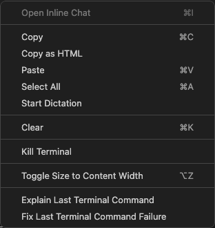

Rath has shortcuts for common project tasks. Use them to explain a confusing terminal result, investigate a failed check, or draft a description of work for review. A terminal is a text window where commands run; a test is a check that a project behaves as expected. These shortcuts start focused tasks, so inspect the results and any proposed changes before relying on them.

## Before you start

Open the relevant project and a Rath chat with a connected model. For terminal help, select the terminal that contains the output. To open the Command Palette, press Ctrl+Shift+P (Cmd+Shift+P on a Mac), then type the action's name.

For helpers that run commands or change files, choose **Ask before changes** and approve the necessary requests, or choose **Full access**. In **Ask before changes**, look-only commands run without asking by default. **Read-only** and **Plan** cannot run commands or make the fixes described below. See [Permission modes](/rath-docs/permissions/).

## Explain or fix terminal output

1. Select the terminal containing the result you want help with.
2. Open the Command Palette and choose **Rath: Explain Last Terminal Command**. You can also find **Explain Last Terminal Command** in the terminal's context menu.
3. Read the resulting **Explain Terminal Output** task. Rath is asked to explain the command and its output, including warnings or errors.
4. If you want Rath to investigate and fix a failure instead, choose **Rath: Fix Last Terminal Command Failure**. Review its explanation and any changes it makes.

These actions send up to the last 120 lines of the active terminal to your connected model. Check that they contain the relevant error and no sensitive information you do not want to share. This limit differs from **Attach terminal output** in chat, which attaches up to 150 lines. For example, after a failed check, use the fix action; after an unfamiliar warning, use the explain action. You can follow up in chat with “Explain that warning without technical jargon” or “What should I check before accepting this fix?”

## Work with project changes

1. Open the Command Palette and choose **Rath: Write Pull Request Description** when you need a review description. A pull request is a proposal to merge changes into another version of a project.
2. Rath starts **Pull Request Description**, reads the branch changes, and is asked to suggest a title and description without changing files or opening the pull request. Check the result against your work and add missing testing details.
3. Choose **Rath: Fix Failing Tests** to ask Rath to find and run the project's tests, investigate failures, and try them again. Review the reported changes and test results.
4. Choose **Rath: Resolve Merge Conflicts** when two sets of changes need reconciliation. Rath is asked to resolve and stage the conflicted files without committing them, and to explain its decisions. Review each resolution before continuing.

For example, after finishing a change, generate a description and ask “Make the summary understandable to a non-specialist.” For conflicting changes, ask “Explain the choice you made in each conflict.” These are requests, not guarantees: Rath may need your decision or be unable to complete a test.

## If it doesn't work

**The active terminal has no output to look at.** means the selected terminal has no readable output. Select the terminal containing the result and try again. If the relevant error is older than the last 120 lines, narrow the output or explain it in chat. If an action cannot run a command or change a file, switch to **Ask before changes** or **Full access** and review any approval request. If Rath reports that a test or conflict needs a decision, inspect its explanation before proceeding.

See [Permission modes](/rath-docs/permissions/), [Reviewing changes](/rath-docs/reviewing-changes/) and [Chatting with Rath](/rath-docs/chatting/).
